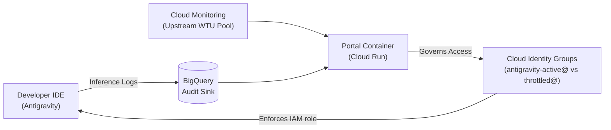
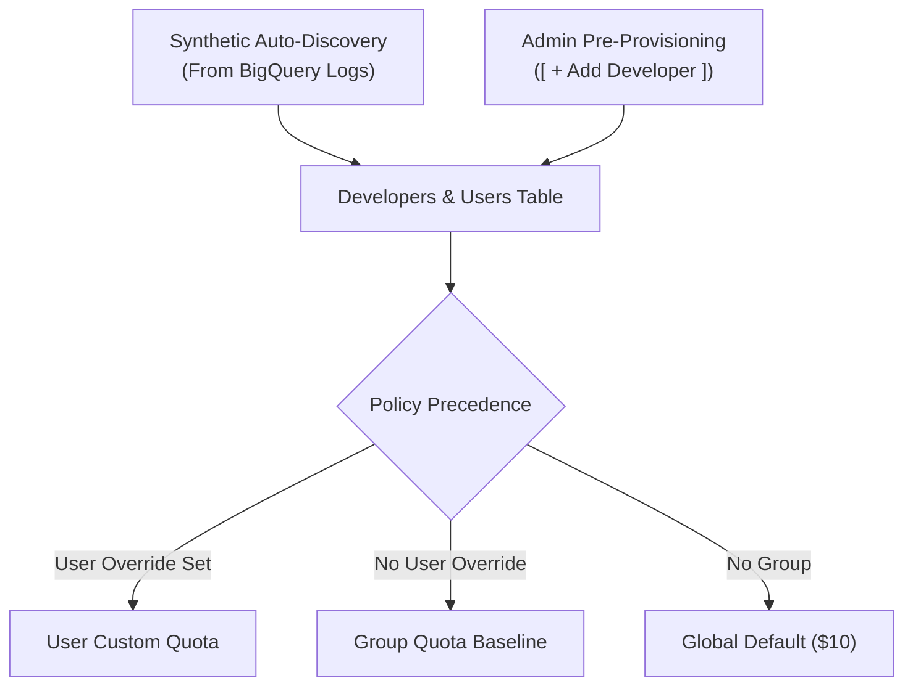

# Customer Onboarding & Setup Guide
## Antigravity Quota & Usage Management Portal

Welcome to the **Antigravity Quota & Usage Management Portal**! This guide walks you through deploying the portal in Google Cloud and configuring governance policies for your organization.

---

## ⚡ Overview in 30 Seconds

Gemini Enterprise enforces subscription quotas as a shared organization-wide pool per GCP project. This portal pairs **real-time upstream subscription pool visibility** with an **automated developer access governance layer**:



### Key Architectural Highlights
* **Single Always-On Cloud Run Service**: Web UI (React/MUI) and REST API (FastAPI) running together with zero cold starts.
* **Serverless Container Build**: Cloud Build compiles and packages the container directly in GCP—**no local Docker or Podman installation required**.
* **Zero External Cron Dependencies**: An embedded hourly background worker evaluates usage automatically.
* **Non-Destructive Access Control**: Governs developer seats dynamically by swapping group membership between `antigravity-active@` (holds `roles/businessaicode.user`) and `antigravity-throttled@` (0 permissions).

---

## 📋 Prerequisites Checklist

Before you begin, ensure you have:

| Requirement | Description | How to Check / Command |
| :--- | :--- | :--- |
| **GCP Project** | Project with billing enabled | `gcloud config get-value project` |
| **GCP Permissions** | Project Owner/Editor + Security Admin | Need permission to grant IAM roles and manage service accounts |
| **Cloud Identity Admin** | Permission to manage groups | Required if Terraform is provisioning Cloud Identity groups |
| **CLI Tools** | Google Cloud SDK & Terraform (or OpenTofu) | `gcloud --version` and `terraform -version` |
| **Customer ID** | Workspace / Cloud Identity Customer ID | Run `gcloud organizations list` (starts with `C`, e.g. `C01234567`) |

Authenticate your local `gcloud` CLI:
```bash
gcloud auth login
gcloud auth application-default login
gcloud config set project YOUR_PROJECT_ID
```

---

## 🚀 Track A: 5-Minute Quickstart (Evaluation & POC)

Use this track to evaluate the portal in under 5 minutes using the secure **Proxy Bridge** (ideal for Cloud Shell, domain-restricted demo environments, or local operator workstations).

### Step 1: Clone and Configure
```bash
git clone <repo-url> antigravity-quota-portal
cd antigravity-quota-portal/terraform
cp terraform.tfvars.example terraform.tfvars
```

Open `terraform.tfvars` and configure the minimal variables:
```hcl
project_id            = "YOUR_PROJECT_ID"
region                = "us-east5" # or your preferred GCP region
customer_id           = "C01234567" # from 'gcloud organizations list'
manage_cloud_identity_groups = true

# Use Proxy mode (private Cloud Run with IAM-authenticated local bridge)
access_mode           = "proxy"
proxy_ingress_type    = "all"
```

### Step 2: Deploy Infrastructure
Run the deployment script or standard Terraform:
```bash
terraform init
terraform apply
```
*Terraform will automatically enable APIs, create the BigQuery dataset and audit log sink, provision Firestore Native, trigger Cloud Build to package the container, and deploy Cloud Run.*

### Step 3: Launch and Connect
Start the authenticated proxy bridge:
```bash
cd ..
./scripts/portal_access.sh proxy
```
* **Local Machine**: Open [http://localhost:8080](http://localhost:8080) in your browser.
* **Google Cloud Shell**: Click **Web Preview** (top-right) → **Preview on port 8080**.

---

## 🏢 Track B: Production Enterprise Deployment

For production deployments requiring browser-based SSO or private corporate network connectivity, choose one of the following ingress modes in `terraform/terraform.tfvars`.

### Option 1: Global External Application Load Balancer + Cloud DNS + Identity-Aware Proxy (`access_mode = "external_lb"`)
Provides secure, browser-based Google SSO for administrators and developers without VPNs or local CLI proxies, while strictly enforcing `--no-allow-unauthenticated` on Cloud Run (`INGRESS_TRAFFIC_INTERNAL_LOAD_BALANCER`).

#### Step 1: Configure Internal OAuth Consent Screen
1. In the [Google Cloud Console — OAuth Consent Screen](https://console.cloud.google.com/apis/credentials/consent), select **Internal** as the User Type so only users in your organization can sign in.
2. Fill in the **App name** (e.g., `Antigravity Quota Portal`), **User support email**, and **Developer contact information**, then click **Save and Continue**.
3. *(Optional)* By default, IAP uses its built-in **Google-managed OAuth client** when `iap_oauth_client_id` and `iap_oauth_client_secret` are left empty. If you also need programmatic OIDC token access through IAP (e.g., for the Concierge Agent), create an **OAuth 2.0 Client ID** (`Web application`) under **Credentials** and add the authorized redirect URI returned by `terraform output iap_oauth_redirect_uri`.

#### Step 2: Configure Cloud DNS Zone & Stage 1 Warmup (`access_mode = "proxy"`, `enable_lb = true`)
Provisioning a Google-Managed SSL Certificate requires DNS propagation and domain validation (typically 10–30 minutes). Using **Stage 1 Warmup** (`access_mode = "proxy"` with `enable_lb = true`) provisions the Global External Load Balancer, Cloud DNS zone/record, Managed SSL Certificate, and IAP backend while keeping `gcloud run services proxy` active until the SSL certificate reaches `ACTIVE`:

```hcl
# Stage 1 Warmup: keep proxy access active while GCLB + DNS + Managed SSL warm up
access_mode           = "proxy"
enable_lb             = true

# Cloud DNS Zone & Subdomain Configuration
# Set manage_dns_zone = true to create a new Cloud DNS Managed Zone,
# or false to use an existing pre-delegated Cloud DNS Managed Zone.
manage_dns_zone       = true
dns_zone_name         = "sub-domain"
dns_zone_domain       = "demo.example.com"
dns_record_prefix     = "quota" # Provisions A-record for quota.demo.example.com (leave "" for apex)

# Identity-Aware Proxy (IAP) Access (automatically includes tenant_domain & Concierge SA)
tenant_domain         = "example.com"
iap_allowed_members   = [
  "domain:example.com",
  "group:antigravity-admins@example.com"
]

# Optional: leave empty for Google-managed IAP OAuth, or set for programmatic OIDC access
iap_oauth_client_id     = ""
iap_oauth_client_secret = ""
```

Run `terraform apply`. If you created a new delegated DNS zone (`manage_dns_zone = true`), retrieve the assigned Cloud DNS name servers and register them with your parent domain registrar:
```bash
terraform output dns_name_servers
```

#### Step 3: Verify DNS Delegation & Managed SSL Readiness
Use `./scripts/portal_access.sh` to check DNS propagation and verify when the Google-Managed SSL Certificate reaches `ACTIVE`:
```bash
# 1. Verify Cloud DNS name servers and A-record IP resolution
./scripts/portal_access.sh dns-check --zone sub-domain --domain quota.demo.example.com

# 2. Check GCLB IP, Managed SSL Certificate ACTIVE status, and IAP readiness
./scripts/portal_access.sh iap-status
```

#### Step 4: Stage 2 Cutover to `external_lb` (and Switching Back to `proxy` Anytime)
Once `iap-status` reports `Status: ACTIVE` (`Verdict: READY FOR GCLB+IAP CUTOVER!`):
- **Option A (Terraform Cutover)**: Set `access_mode = "external_lb"` in `terraform/terraform.tfvars` and run `terraform apply` (locks Cloud Run ingress to `INGRESS_TRAFFIC_INTERNAL_LOAD_BALANCER`).
  - *Tip*: Set `allow_proxy_with_lb = true` if you want both `https://quota.demo.example.com` (GCLB + IAP) and `./scripts/portal_access.sh proxy` (`localhost:8080`) to work simultaneously.
- **Option B (Instant 3-Second CLI Switch / Rollback)**: Switch Cloud Run ingress between `external_lb`, `proxy`, or `dual` mode at any time without waiting for Terraform:
  ```bash
  # Lock Cloud Run ingress to GCLB + IAP only
  ./scripts/portal_access.sh switch-mode external_lb

  # Instantly switch back to proxy mode (gcloud run services proxy)
  ./scripts/portal_access.sh switch-mode proxy

  # Allow both GCLB + IAP and gcloud run services proxy simultaneously
  ./scripts/portal_access.sh switch-mode dual
  ```
- **Terraform Rollback to Proxy**: Setting `access_mode = "proxy"` with `enable_lb = true` performs a warm rollback (keeping the Global Static IP, DNS record, and `ACTIVE` SSL certificate warm for instant re-enablement), while setting `enable_lb = false` tears down the GCLB resources cleanly (use `retain_lb_ip = true` if you wish to keep the static IP and DNS record reserved).

### Option 2: Private Corporate VPC (`access_mode = "internal_lb"`)
Routes traffic through a Regional Internal Application Load Balancer accessible only within your private VPC, Interconnect, or VPN.

1. Set variables in `terraform/terraform.tfvars`:
   ```hcl
   access_mode = "internal_lb"
   vpc_network = "your-vpc-network"
   vpc_subnet  = "your-vpc-subnet"
   ```
2. Run `terraform apply`. Access the dashboard via the returned internal IP address from within your corporate network.

---

## ⚙️ Step-by-Step Dashboard Configuration

Once deployed, log into the dashboard to complete initial setup and establish your quota policies.

### Step 1: Initial Portal & Governance Settings
Click the **Settings (Gear)** icon in the top-right app bar:

1. **Portal Display Timezone**: Select your organization's primary timezone (e.g. `America/New_York` or `UTC`).
   * *Note*: Weekly quota resets automatically synchronize with the upstream Google Cloud Credit Pool start time. The timezone configured here serves as display formatting and fallback.
2. **IAM Gatekeeper Groups**: Verify the group emails:
   * **Active Group**: e.g. `antigravity-active@yourdomain.com` (assigned `roles/businessaicode.user`).
   * **Throttled Group**: e.g. `antigravity-throttled@yourdomain.com` (0 permissions; holds paused developers).
3. **Default Budget Credits & Overage Buffer**:
   * **Default Quota**: Default weekly credit assigned to new developers (default: `$10.00`).
   * **Default Overage Buffer**: Buffer allowed before auto-throttling kicks in (default: `$2.00`).
4. **Alert Webhook (Optional)**: Provide a Slack or Microsoft Teams incoming webhook URL to receive notifications when developers exceed thresholds.
5. Click **Save Settings**.

---

### Step 2: Configure Quota Management Groups
Navigate to the **Quota Groups** tab. Groups allow you to govern quota policies across teams at scale without setting individual user allowances.

1. **Review Pre-Seeded Groups**:
   * **Developers**: Default `$50.00/wk` quota, `$10.00/wk` buffer.
   * **Business Users**: Default `$10.00/wk` quota, `$2.00/wk` buffer (newly discovered users default here).
2. **Create Custom Groups**:
   * Click **[ + Create Group ]** to add tiers (e.g., *Data Science Team*, *Contractors*, or *VIPs*).
   * Specify baseline quota, overage buffer, and whether the group is exempt from auto-throttling.
3. **Bulk Assign Members**:
   * Click **Assign Members** on any group card.
   * Paste comma- or newline-separated developer email addresses.
   * Toggle **"Reset custom user quotas to group baseline"** to standardize allowances across members in one click.

---

### Step 3: Manage Developers & Quota Overrides
Navigate to the **Developers & Users** tab.



1. **User Discovery**:
   * **Synthetic Auto-Discovery**: Developers who execute prompts in Antigravity are discovered from BigQuery audit logs and automatically added to the default group.
   * **Pre-Provisioning**: Click **[ + Add Developer ]** to assign quotas before a user's first prompt.
2. **Setting Individual Custom Quotas**:
   * Click on any user row or click **Manage** to open the user drawer.
   * Adjust **Custom Quota ($)** or **Overage Buffer ($)** for project leads or specific workload requirements.
   * *To revert back to group policy*: Click the **"Adopt Group Quota"** button in the policy banner.
3. **Exemptions & Manual Locks**:
   * **Exemption**: Check *Exempt from Quota Limits* to monitor usage without ever auto-throttling (e.g., senior architects).
   * **Manual Lock**: Click **Lock Developer** to place a protected administrative hold. *Manually locked accounts remain locked across weekly resets until an admin explicitly unlocks them.*

---

### Step 4: Verify Token Pricing Matrix
Click the **Pricing Matrix ($)** button in the top app bar to review model rates:

* The system computes developer spend based on the granular token counts in BigQuery inference logs (`promptTokenCount`, `candidatesTokenCount`, `cachedContentTokenCount`, and `thoughtsTokenCount`).
* Rates are pre-configured for Gemini 2.0 Flash, Flash Thinking, and Gemini Pro 1.5/2.5/3.0.
* Verify or adjust the pricing per 1,000,000 tokens to match your enterprise contract rates, then click **Save Matrix**.

---

### Step 5: Quota Requests & Developer Self-Service
Developers can manage their own quota by visiting the self-service page at `/my-quota`.

1. **Developer Self-Service Experience (`/my-quota`)**:
   * Displays real-time spend, credit progress, and live reset countdown.
   * Shows a **🟡 WARNING (80%+ Used)** badge as developers approach their limit, allowing them to request an increase before getting blocked mid-task.
   * Click **[ Request Quota Increase ]** to submit a request with reason category (e.g., `🚀 Sprint Deadline`, `🛠️ Refactoring`), amount (`+$15`, `+$25`, `+$50`), and duration (`Temporary (Weekly)` vs `Permanent`).
2. **Admin Review Queue**:
   * Administrators navigate to the **Quota Requests** tab.
   * Inspect pending requests by category and justification.
   * **Approval Flexibility**: Adjust the approved dollar amount or switch duration from permanent to temporary directly in the approval dialog.
   * **Bulk Approvals**: Multi-select requests and click **[ Bulk Approve Selected (Temporary) ]**.
   * **Instant Unthrottling**: Approving an over-quota developer immediately restores them to `ACTIVE` and swaps them back into `antigravity-active@`.

---

### Step 6: Publishing & Identity Synchronization

The portal provides a **deferred synchronization** workflow so admins can stage multiple edits without thrashing Cloud Identity groups:

* **Staging Changes**: Group modifications, quota bumps, and member assignments update immediately in Firestore.
* **Publish & Sync**: Click the blue **[ Publish & Sync ]** button in the top-right app bar.
  * Reconciles all developer statuses in real-time (< 2 seconds).
  * Automatically swaps developers between `antigravity-active@` and `antigravity-throttled@`.
  * Instantly force-refreshes the upstream Cloud Monitoring quota pool telemetry.
* **Automated Safety Net**: If you don't click Publish, the embedded background evaluator automatically runs every hour.

---

## 🔍 Verification & Day-2 Operations

### Health & Telemetry Verification
1. **Health Check**:
   ```bash
   curl -i http://localhost:8080/api/health
   # Returns status: "healthy", mock_mode: false, cloud_identity_managed: true
   ```
2. **Upstream Quota Pool**:
   * On the dashboard header, verify the **Antigravity Weekly Quota Pool** hero card displays your active license tier (e.g., `Tier: Gemini Enterprise Plus`), raw WTU usage, and countdown to the official Google Cloud reset window.
3. **Audit Trail**:
   * Click the **Audit Log** button in the app bar to view real-time governance events (group swaps, quota changes, approvals, admin publishes).
   * All audit events are dual-written to GCP Cloud Logging under log name `antigravity-quota-audit`.

### Weekly Reset Behavior
* When the upstream Google Cloud Credit Pool resets (every 7 days), weekly gross spend resets to `$0.00`.
* All `Auto-Throttled` developers are automatically restored to `ACTIVE` and re-added to `antigravity-active@`.
* Temporary quota approvals expire and automatically revert back to group baselines.
* Developers with administrative **Manual Locks** remain safely locked.

---

## 🆘 Troubleshooting FAQ

<details>
<summary><b>Q: A developer reached their quota limit. How do I unlock them immediately?</b></summary>

1. Locate the developer in the **Developers & Users** table.
2. Click **Manage** to open the drawer.
3. Increase their **Custom Quota** or assign them to a higher **Quota Group** so their limit exceeds their current spend.
4. Click **Publish & Sync** in the top-right app bar. The developer is instantly unthrottled and restored to `antigravity-active@` within seconds.
</details>

<details>
<summary><b>Q: Why do I see "Discovery Mode Active" in the user table?</b></summary>

This means the system discovered developers from BigQuery inference logs who were not pre-provisioned. They are automatically enrolled into the default **Business Users** quota group.
</details>

<details>
<summary><b>Q: Can I run this locally without live GCP credentials?</b></summary>

Yes! Set `USE_MOCK_SERVICES=true` or run:
```bash
uv run scripts/run_local_demo.py
```
This launches a standalone mock sandbox pre-seeded with 3 demo developers illustrating each lifecycle state (Active, Warning, and Auto-Throttled).
</details>

---

## 📚 Related Documentation
* [Technical Design Document & Specification](SPECIFICATION.md)
* [Terraform Module Reference](terraform/)
* [API Endpoint Reference](README.md#api-endpoints-reference)
