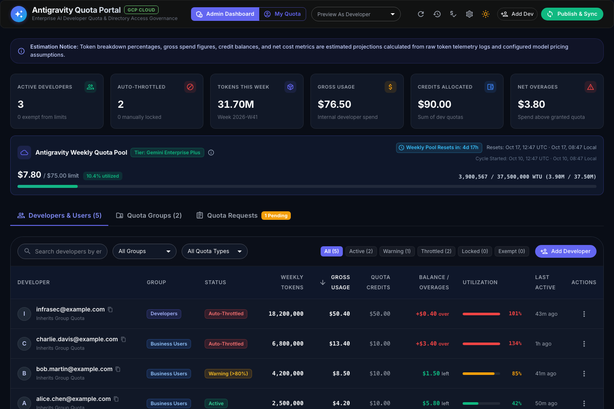
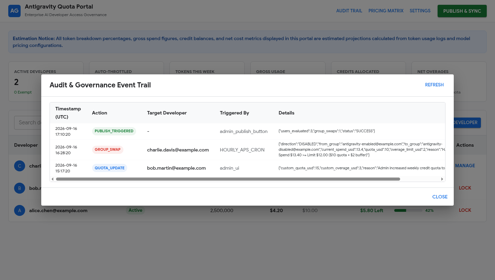
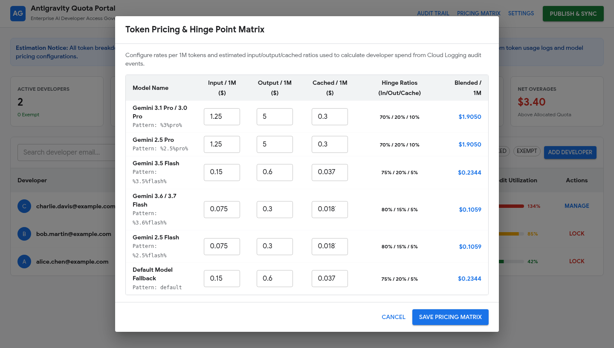
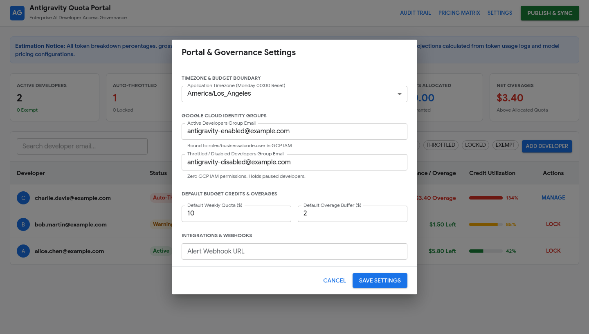
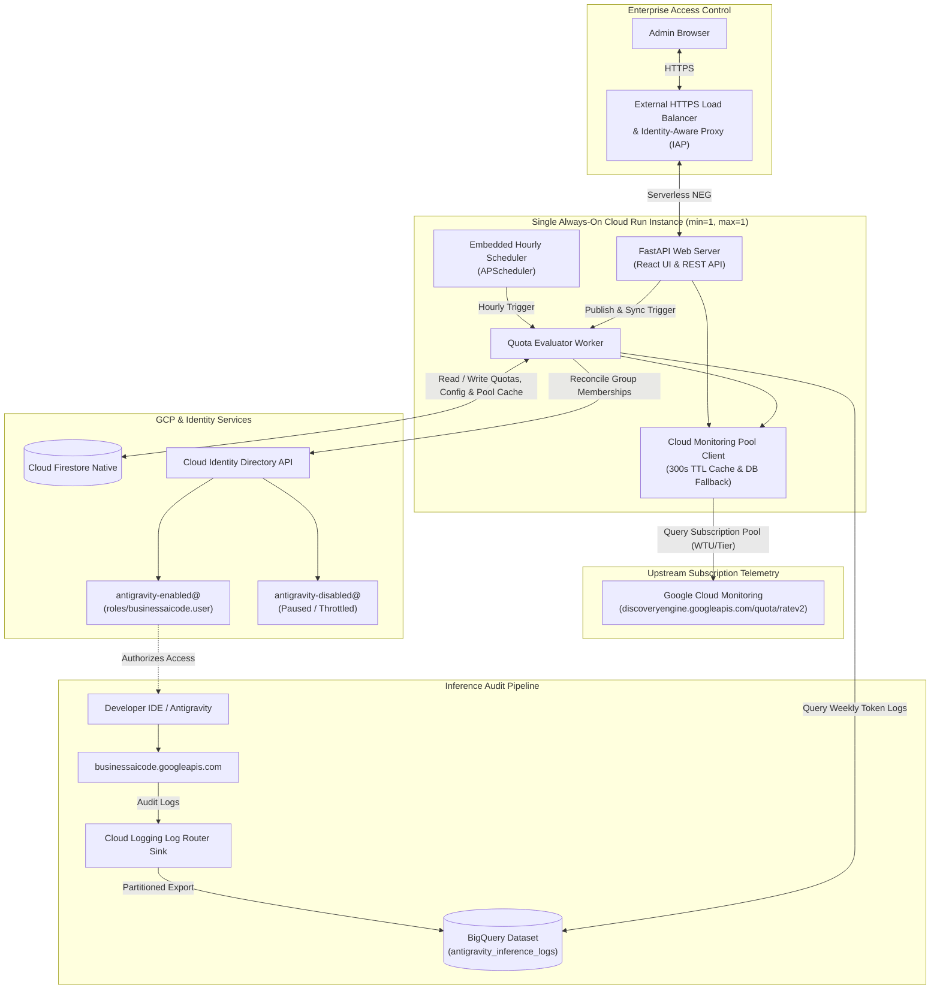
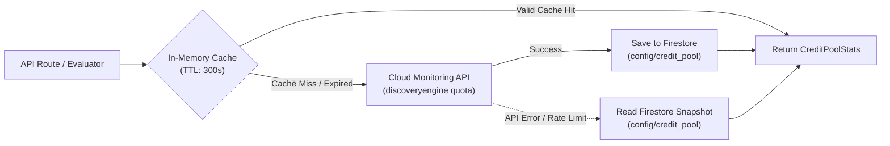

# Antigravity Quota & Usage Management Portal

> [!IMPORTANT]  
> This project is not provided by Google and does not come with any support or warranties. This project serves as a proof of concept for how it's possible implement a quota system with Antigravity.  
> Though functional, you may wish to change the design for increased reliability or feature detail.  

> [!IMPORTANT]  
> Accurate as of 9/16/2026  

> [!NOTE]
> **Independent Quota Governance & Upstream Pool Visibility**: Gemini Enterprise enforces subscription quota as a pooled entitlement at the GCP project level. This portal pairs **live upstream visibility** (reading organization-wide rate quota metrics from Google Cloud Monitoring) with an **independent per-developer allocation and governance layer** (where administrators define per-developer credit budgets, track usage from BigQuery audit logs, and enforce access via Cloud Identity groups).

**What this is**  
- a single-container, deployed to GCP Cloud Run, with Terraform IaC module
- a frontend: React 18 SPA (Vite, TypeScript, Material UI / MUI)
- an API: FastAPI (Python 3.11+) with Uvicorn and embedded APScheduler
- telemetry sources: Google Cloud Monitoring (live upstream subscription quota pool & reset schedules) and BigQuery (per-developer inference audit logs)
- data storage: Cloud Firestore Native (quotas, configuration, and pool metric cache fallback)

**Why this exists**
- Gemini Enterprise manages subscription quota as a shared organization-wide pool per GCP project and does not provide native per-developer quota limits or self-service throttling.

**What this is not**
**What this is not**
- **Not a direct quota limit mutator**: This project reads upstream subscription quota metrics from Google Cloud Monitoring, but does not modify Google's internal project quota limits. Instead, it **governs developer access** to the pooled quota by dynamically managing membership in Cloud Identity IAM gatekeeper groups (`antigravity-active@` vs `antigravity-throttled@`).
- **Not a GCP billing or invoicing engine**: Because Gemini Enterprise pools quota across the entire GCP project, an individual developer exceeding their credit allowance does not necessarily trigger external Google Cloud billing if total project consumption remains within its pooled entitlement.

**How it works**
- developers are added and removed from IAM Gatekeeper groups (`antigravity-active@` and `antigravity-throttled@`) to enable and disable access for Antigravity Quota usage
- live organization-wide subscription metrics (Tier, Raw WTU, Contract USD, and Reset Countdown) are fetched from Google Cloud Monitoring with in-memory caching and Firestore fallback
- an `hourly_quota_evaluator` (and on-demand **Publish & Sync**) performs automated group reconciliation
- **auto-throttled** developers automatically unlock and return to `antigravity-active@` on the next hourly evaluation (or instantly upon clicking **Publish & Sync**) whenever an admin increases their quota or overage buffer
- weekly usage resets automatically in synchronization with the upstream Google Cloud Credit Pool start time (falls back to Monday 00:00 in configured timezone if telemetry is unavailable), resetting spend to $0 and auto-re-enabling throttled developers
- **manually locked** developers are protected administrative holds that remain disabled across resets until an admin explicitly unlocks them

**Features**
1. **Antigravity Weekly Quota Pool (Cloud Monitoring Telemetry)**:
    * **Live Subscription Pool Visibility**: Directly queries Google Cloud Monitoring (`discoveryengine.googleapis.com/quota/ratev2/...`) to track organization-wide subscription consumption in real-time.
    * **Auto-Detected License Tier**: Dynamically detects the active contract tier (e.g. `Tier: Gemini Enterprise Plus` at 37.5M WTU / $75.00/wk, `Tier: Gemini Enterprise Standard` at 40M WTU / $80.00/wk, or `Consumption-Only / Flex`).
    * **Dual WTU & USD Metrics**: Visualizes raw token usage (Workload Token Units) alongside contract dollar limits ($2.00 per 1M WTU) with multi-stage progress bars and utilization percentages.
    * **Upstream Reset Countdown**: Tracks the official Google Cloud reset window (`window_start_time`), displaying live countdowns (`Weekly Pool Resets in: Xd Xh`) alongside exact UTC and localized timestamps matching the Google Cloud Console.
    * **In-Memory TTL Cache & Resilient Firestore Fallback**: 300-second in-memory caching prevents API rate limits; automatically writes to and falls back on Firestore document `config/credit_pool` during transient network or API disruptions.
2. **Quota Management Groups & 3-Tier Policy Inheritance**:
    * **Enterprise Scale**: Designed for organizations with 15,000+ Gemini Enterprise licenses where updating quotas per user is impractical.
    * **Built-in Groups**: Pre-seeded with **Developers** ($50.00/wk quota, $10.00/wk buffer) and **Business Users** ($10.00/wk quota, $2.00/wk buffer, default for discovered users).
    * **3-Tier Precedence**: `User Custom Quota > Group Quota > Organization Global Default`. Changing a group's quota instantly applies to all members without individual overrides.
    * **Group Exemption Inheritance**: Setting `is_exempt` on a group cascades to all members, exempting them from auto-throttling.
    * **Full Group Management API**: Create, update, delete custom quota groups (`/api/groups`) and batch assign members.
3. **FinOps Credit & Developer Overage Model**:
    * Quotas are allocated as weekly dollar credits (`Q`, default `$10.00`) with remaining credit balance `B_credit = max(0, Q - C_gross)`.
    * Developer overage tracks usage beyond their assigned quota target: `C_overage = max(0, C_gross - Q)` with configurable overage buffer (`O`).
    * Because Gemini Enterprise uses pooled project-level quotas, this metric reflects internal developer consumption exceeding assigned policy targets rather than external Google Cloud billing liability.
    * **Granular Token Telemetry & Precise Pricing**: Calculates gross spend directly from the exact token counts emitted in Antigravity inference logs (`metadata.promptTokenCount`, `metadata.candidatesTokenCount`, `metadata.cachedContentTokenCount`, and `metadata.thoughtsTokenCount`), mapping specific rates for prompt/input, generated output, cached context, and reasoning/thinking tokens (with fallback ratio modeling if only aggregate `totalTokenCount` is present).
    * Upstream Credit Pool-aligned weekly windows (synchronized with Cloud Monitoring quota window start, with Portal Display Timezone fallback) with historical snapshots archived to Firestore.
4. **Dual-Group Cloud Identity State Machine**:
    * **`antigravity-active@`**: Bound to IAM role `roles/businessaicode.user` (enforces access).
    * **`antigravity-throttled@`**: Zero IAM permissions (paused developers).
    * **Dynamic Auto-Unthrottle (Quota Expansion)**: If an `Auto-Throttled` developer's quota credits or overage buffer is increased so that $\text{Spend} < \text{Limit}$, the hourly evaluator (or clicking **Publish & Sync**) automatically restores their `ACTIVE` status and moves them back to `antigravity-active@` with zero manual group editing required.
    * **Weekly Credit Pool Auto-Reset**: When the upstream Google Cloud Credit Pool resets (7-day window detected via Cloud Monitoring, or Monday 00:00 fallback), weekly gross spend resets to `$0.00` and all `Auto-Throttled` developers are automatically re-enabled into `antigravity-active@`.
    * **Administrative Lock Protection**: Distinguishes automated spend limits from `MANUALLY_DISABLED` (administrative locks that are protected from weekly resets and remain locked until explicitly unlocked by an admin).
    * **Quota Exemption**: Supports `is_exempt` to bypass quota limits for leads/VIPs while retaining full usage analytics.
5. **Developer Onboarding & Synthetic Discovery**:
    * **Synthetic Discovery**: Automatically discovers active developers from BigQuery inference logs and registers them with the default Quota Management Group (`Business Users`).
    * **Manual Pre-provisioning**: Admins can pre-provision developers in the UI or via REST API with group assignment or custom quotas prior to their first prompt.
6. **Deferred Sync with Instant Publish**:
    * Admins can edit developer quotas, toggle exemptions, modify group baselines, and update pricing matrix in drafts.
    * Clicking **"Publish & Sync"** executes an instant in-process evaluation and reconciles Cloud Identity groups in real-time (<2s), immediately unthrottling developers who received quota increases without waiting for the next cron cycle.
    * Built-in `APScheduler` runs hourly evaluation as an automated safety net.
7. **Two-Tab Material Design 3 (MUI) Dashboard**:
    * Two distinct top-level tabs: **Developers & Users** and **Quota Groups**.
    * **Developers & Users Tab**: Sortable, filterable developer table with color-coded credit utilization progress bars, group chips, group filter dropdown, client-side pagination (10, 25, 50, 100 rows per page), and contextual action buttons (Lock, Unlock, Manage).
    * **Quota Groups Tab**: Visual card grid of all quota management groups with member counts, aggregate spend, token volume, baseline quota controls, and instant "View Members" drilldown.
    * Hero **Antigravity Weekly Quota Pool** card displaying organization tier, reset countdown, and dual WTU/USD progress bars.
    * Real-time KPI summary cards (Active Developers, Auto-Throttled, Weekly Tokens, Gross Usage, Credits Allocated, Net Overages).
    * Pinned legal/accounting estimation disclaimer banner.
    * Interactive slide-out drawer with financial ledger, model token distribution, quota management group selector, and custom quota controls.
    * Governance audit trail log viewer and model pricing matrix editor.
8. **Enterprise Security & Automated Infrastructure**:
    * Provisions APIs, BigQuery dataset, Cloud Logging Sink, Firestore Native Database, Service Account with least-privilege IAM, Artifact Registry repository, and Cloud Run v2 service in the same GCP project via Terraform (`terraform/`).
    * **Zero-Trust Access with IAP**: Full External HTTPS Application Load Balancer integrated with Google Identity-Aware Proxy (IAP) and least-privilege IAM for secure, browser-based SSO.
    * **Automated `sslip.io` DNS & Managed SSL**: Automatically provisions Google-managed SSL certificates using derived `sslip.io` hostnames (e.g. `34-36-64-200.sslip.io`) without requiring a custom domain, with optional custom domain override support.
    * **Local Sandbox & Mock Mode**: Runs out-of-the-box with `USE_MOCK_SERVICES=true` without requiring live GCP credentials.

---

## Visual Tour & Interface

### Developer Access & Quota Dashboard


### Audit & Governance Event Trail
Real-time dual-written audit trail tracking group swaps, manual locks, admin publishes, and quota updates.


### Token Pricing & Hinge Point Matrix
Dynamic per-million token rates and input/output/cached hinge point ratios for accurate gross spend estimation.


### Portal & Governance Settings
Configurable weekly budget boundaries, application timezones, Cloud Identity groups, and alert webhook endpoints.


---

## Architecture Overview



---

## Antigravity Inference Log Schema & Token Telemetry

Inference telemetry is exported from Cloud Logging to BigQuery via the log sink from `businessaicode.googleapis.com/inference_response`. Each log entry provides a structured `jsonpayload_v1_inferenceresponselog.metadata` payload containing granular token telemetry per request:

```json
"metadata": {
  "totalTokenCount": 8920,
  "promptTokenCount": 7450,
  "candidatesTokenCount": 1470,
  "cachedContentTokenCount": 256,
  "thoughtsTokenCount": 0,
  "truncated": false
}
```

### Telemetry Field Breakdown

| Log Field | Type | Description & Billing Mapping |
| :--- | :---: | :--- |
| `promptTokenCount` | `int64` | **Input / Prompt Tokens**: Total input tokens submitted in the request (prompts, instructions, tool declarations). Billed at model input price $P_{\text{in}}$. |
| `candidatesTokenCount` | `int64` | **Output / Candidate Tokens**: Generation tokens produced by the model across response candidates. Billed at model output price $P_{\text{out}}$. |
| `cachedContentTokenCount` | `int64` | **Cached Context Tokens**: The subset of prompt tokens served from Gemini Context Caching. Billed at the discounted cache read rate $P_{\text{cached}}$ rather than full input price. |
| `thoughtsTokenCount` | `int64` | **Reasoning / Thinking Tokens**: Internal reasoning/chain-of-thought tokens produced during inference (e.g. Gemini 2.0 Flash Thinking / Gemini 3 Pro). Billed under output token pricing. |
| `totalTokenCount` | `int64` | **Total Token Volume**: Combined token sum for the inference call: $\text{promptTokenCount} + \text{candidatesTokenCount} = \text{totalTokenCount}$ (e.g. $7450 + 1470 = 8920$). |
| `truncated` | `bool` | **Truncation Flag**: Indicates whether generation was truncated due to token limit (`max_output_tokens`) or safety cutoff. |

### Granular Spend Calculation

Using this telemetry, exact gross spend is determined without relying on arbitrary synthetic ratios:

$$\text{Effective Input Tokens} = \max(0, \text{promptTokenCount} - \text{cachedContentTokenCount})$$
$$\text{Cached Tokens} = \text{cachedContentTokenCount}$$
$$\text{Output Tokens} = \text{candidatesTokenCount} + \text{thoughtsTokenCount}$$

$$C_{\text{gross}} = \left( \frac{\text{Effective Input}}{1{,}000{,}000} \times P_{\text{in}} \right) + \left( \frac{\text{Cached}}{1{,}000{,}000} \times P_{\text{cached}} \right) + \left( \frac{\text{Output}}{1{,}000{,}000} \times P_{\text{out}} \right)$$

> [!NOTE]  
> If an older log record or summarized entry only provides `totalTokenCount` (with granular sub-counts missing or null), the system gracefully falls back to the per-model estimated ratios ($w_{\text{in}}, w_{\text{out}}, w_{\text{cached}}$) defined in the model pricing matrix.

---

## Antigravity Weekly Quota Pool & Upstream Cloud Monitoring Telemetry

While BigQuery inference logs provide granular, per-developer token attribution, Gemini Enterprise enforces subscription rate limits as a **pooled entitlement** across the entire Google Cloud project. 

The portal queries Google Cloud Monitoring to provide real-time visibility into this upstream organization subscription pool alongside internal developer allocations.

### Upstream Metrics & Tier Auto-Detection

The `CloudMonitoringPoolClient` queries metric descriptor `discoveryengine.googleapis.com/quota/ratev2/net_usage` and `discoveryengine.googleapis.com/quota/ratev2/limit`, auto-detecting the active subscription tier:

| Metric Name (`quota_metric_name`) | Subscription Tier | Weekly WTU Limit | Contract USD Value | WTU Conversion Rate |
| :--- | :--- | :---: | :---: | :---: |
| `agentic_wtu_tier_enterprise_plus_pp_weekly_regional` | **Gemini Enterprise Plus** | `37,500,000 WTU` | **$75.00** | $2.00 / 1M WTU |
| `agentic_wtu_tier_enterprise_standard_pp_weekly_regional` | **Gemini Enterprise Standard** | `40,000,000 WTU` | **$80.00** | $2.00 / 1M WTU |
| `agentic_wtu_tier_consumption_only_pp_weekly_regional` | **Consumption-Only / Flex** | Dynamic / Uncapped | Variable | $2.00 / 1M WTU |

### Official Reset Schedule & Live Countdown

The weekly rate quota window is maintained by Google Cloud's Quota Service. 
1. **Window Start Timestamp**: Extracted directly from the metric point label `window_start_time` (e.g. `1791645425` $\rightarrow$ `2026-10-10 15:17:05 UTC`).
2. **Next Reset Calculation**: Calculated as $\text{Window Start} + 7 \text{ days}$ (e.g. `2026-10-17 15:17:05 UTC`).
3. **Live Countdown Badge**: The dashboard computes the remaining duration and displays `Weekly Pool Resets in: Xd Xh` alongside formatted UTC and local browser timestamps.

### Caching, Resilience & Firestore Fallback



- **300s TTL Caching**: High-frequency dashboard refreshes are served from in-memory cache, eliminating unnecessary API quota consumption.
- **Firestore Snapshot Fallback**: Every live reading writes to `config/credit_pool`. If Cloud Monitoring is unreachable, the system automatically serves the last persisted snapshot.
- **Scheduled Background Refresh**: The embedded `APScheduler` job and manual **Publish & Sync** triggers refresh the pool stats in the background.

---

## Project Structure

```
antigravity-quota-portal/
├── SPECIFICATION.md
├── pyproject.toml               # Python package configuration
├── Dockerfile                   # Multi-stage container build
├── Containerfile                # Podman container definition
├── README.md
├── terraform/                   # Terraform IaC Module
│   ├── main.tf                  # Providers & APIs
│   ├── locals.tf                # Ingress & Argolis identity logic
│   ├── cloud_identity.tf        # Cloud Identity Groups & Dual-Group Governance Automation
│   ├── bigquery.tf              # Dataset & Cloud Logging Sink
│   ├── firestore.tf             # Firestore Native Database
│   ├── iam.tf                   # Service Account & Least-Privilege IAM (Monitoring, BQ, Firestore)
│   ├── cloud_build.tf           # Serverless Cloud Build container orchestration
│   ├── cloud_run.tf             # Artifact Registry & Cloud Run v2 Service
│   ├── internal_lb.tf           # Regional Internal Application Load Balancer
│   ├── lb.tf                    # External HTTPS Load Balancer & IAP
│   ├── variables.tf             # Inputs & access_mode options
│   ├── outputs.tf               # Resource endpoints & access commands
│   └── terraform.tfvars.example # Example configuration
├── scripts/
│   ├── argolis_access.sh        # IAM authenticated proxy bridge & CLI helper
│   ├── validate_pool.py         # Standalone Cloud Monitoring Quota Pool validator CLI
│   ├── run_local_demo.py        # Local sandbox runner (seeds 3 demo users)
│   ├── seed_demo_data.py        # REST API demo user seeder script
│   ├── capture_screenshot.py    # Headless Chrome dashboard screenshot capture
│   ├── build_and_push.sh        # Cloud Build / container build & push script
│   └── deploy_terraform.sh      # Terraform deploy script
├── frontend/                    # Material UI React Application
│   ├── package.json
│   ├── vite.config.ts
│   ├── index.html
│   └── src/
│       ├── main.tsx
│       ├── App.tsx
│       ├── theme.ts             # Google Cloud Material 3 Theme
│       ├── components/          # UI Components (Hero Pool Card, FinOps KPIs, User Table)
│       └── services/api.ts      # REST API Client
├── app/
│   ├── main.py                  # FastAPI Application & APScheduler
│   ├── config.py                # Environment configuration
│   ├── audit/                   # GCP Cloud Logging audit emitter & mock
│   ├── monitoring/              # Cloud Monitoring Quota Pool client & mock
│   │   ├── pool_client.py       # Live metric queries, 300s TTL cache, Firestore fallback
│   │   └── mock_pool.py         # Local mock pool client
│   ├── core/                    # Cost math, timezone engine & state machine
│   ├── db/                      # Firestore client & Mock DB (includes credit_pool persistence)
│   ├── bq/                      # BigQuery client & Mock BQ
│   ├── identity/                # Cloud Identity client & Mock Identity
│   ├── api/                     # REST API routes (KPIs with credit_pool payload)
│   └── static/                  # Production static SPA bundle
└── tests/                       # Unit & Integration Tests
    ├── test_cost_model.py
    ├── test_timezone.py
    ├── test_state_machine.py
    ├── test_evaluator.py
    ├── test_pool_client.py      # Pool client, caching, and DB fallback tests
    ├── test_audit_gcp.py
    └── test_api.py
```

---

## Local Development & Testing

### Running Tests
```bash
# Run backend pytest suite
uv run pytest -v tests/
```

### Running Locally in Mock Sandbox Mode

#### Option A: Dedicated 3-User Sandbox Runner (Recommended)
Launches the portal pre-seeded with **3 users** demonstrating each quota lifecycle state (Active Normal, Active Warning, and Auto-Throttled):
```bash
uv run scripts/run_local_demo.py
```
Open [http://localhost:8080](http://localhost:8080) to interact with the dashboard.

#### Option B: Standard Uvicorn / Podman Runner
```bash
# Direct via Python / uv
export USE_MOCK_SERVICES=true
uv run uvicorn app.main:app --reload --port 8080

# Or via Podman container
podman build -t antigravity-quota-portal:local .
podman run -d -p 8080:8080 antigravity-quota-portal:local
```

#### Seeding Users to an Already Running Portal
If the portal is already running, insert demo users at any time via the REST API helper script:
```bash
uv run scripts/seed_demo_data.py --url http://localhost:8080
```

#### Capturing UI Screenshots Headless
To automatically launch the 3-user mock sandbox, render the Material UI interface in headless Chrome, and capture fresh high-resolution screenshots to `docs/images/` (`portal_dashboard.png`, `portal_audit_log.png`, `portal_pricing_matrix.png`, and `portal_settings.png`):
```bash
uv run scripts/capture_screenshot.py
```

---

## Container Build & GCP Deployment

The deployment pipeline is fully orchestrated by Terraform using **Google Cloud Build**, requiring **zero local Docker or Podman installation**.

### Step 1: Configure Environment Variables
Configure your GCP project, region, and Argolis settings in `terraform/terraform.tfvars`:
```bash
cd terraform
cp terraform.tfvars.example terraform.tfvars
# Edit terraform.tfvars with your GCP project ID, region, and group emails
```

### Step 2: Deploy Infrastructure
Run standard Terraform initialization and apply. Terraform automatically enables APIs, provisions Artifact Registry, triggers a Google Cloud Build to compile and push the container image to Artifact Registry, and deploys the Cloud Run v2 service:
```bash
terraform init
terraform apply
```

No local container runtime is needed. Cloud Build automatically handles multi-stage container compilation and pushes the image directly to `${REGION}-docker.pkg.dev/${PROJECT_ID}/antigravity-portal/antigravity-quota-portal:latest`.

---

## Cloud Identity Groups & Dual-Group Governance Automation

Terraform automates the end-to-end lifecycle of the two Google Cloud Identity groups that govern Antigravity seat allocation:
- **`antigravity-enabled@<domain>`**: Developers with active weekly quota. Members automatically receive `roles/businessaicode.user` on the Google Cloud project to use Google Antigravity.
- **`antigravity-disabled@<domain>`**: Throttled developers who have exceeded their quota and overage buffer. The IAM role is revoked until the next weekly boundary reset (or manual admin quota replenishment).

### Automated Provisioning in Terraform
When `manage_cloud_identity_groups = true` and `customer_id` is supplied:
1. `google_cloud_identity_group.enabled_group`: Provisions the enabled group under `customers/${customer_id}`.
2. `google_cloud_identity_group.disabled_group`: Provisions the throttled group under `customers/${customer_id}`.
3. `google_cloud_identity_group_membership.portal_sa_enabled_membership`: Adds the Cloud Run Service Account as an **OWNER** of the enabled group so it can add and remove developers programmatically via the Cloud Identity API.
4. `google_cloud_identity_group_membership.portal_sa_disabled_membership`: Adds the Cloud Run Service Account as an **OWNER** of the disabled group.
5. `google_project_iam_member.enabled_group_businessaicode_user`: Binds `roles/businessaicode.user` to `group:${var.enabled_group_email}` on the GCP project.

To discover your Cloud Identity Customer ID:
```bash
gcloud organizations list
# or
gcloud identity groups search --labels="cloudidentity.googleapis.com/groups.discussion_forum"
```

---

## Google Cloud Argolis & Secure Private Deployments

Google Cloud Argolis demo environments enforce strict organization policies (such as `constraints/run.allowedIngress` and `constraints/iam.allowedPolicyMemberDomains`) that prevent unauthenticated public internet exposure. The Terraform module supports zero-public-exposure deployments tailored for Argolis and enterprise zero-trust requirements.

### Access Modes & Ingress Governance

| Access Mode | Ingress Policy | Authentication | Recommended For | Network Path |
| :--- | :---: | :---: | :--- | :--- |
| **`proxy`** *(Default)* | `internal` (`INGRESS_TRAFFIC_INTERNAL_ONLY`) | Strict IAM (`roles/run.invoker`) | Argolis demo environments, Cloud Shell, and local operator access | Cloud Run Private Ingress $\rightarrow$ Authenticated Proxy Bridge (`localhost:8080`) |
| **`internal_lb`** | `internal-and-cloud-load-balancing` | VPC Subnet / IAM | Private VPC access from Compute Engine VMs or Cloud Interconnect | Regional Internal ALB $\rightarrow$ VPC Serverless NEG $\rightarrow$ Private Cloud Run |
| **`external_lb`** | `internal-and-cloud-load-balancing` | Google Identity-Aware Proxy (IAP) | Production enterprise with public DNS and browser-based SSO | External HTTPS ALB $\rightarrow$ IAP OAuth $\rightarrow$ Serverless NEG $\rightarrow$ Cloud Run |

### Configuration for Argolis (`terraform.tfvars`)

```hcl
# Set access mode to proxy (strictly private, no public ingress)
access_mode = "proxy"

# Argolis tenant identity binding (automatically binds domain:gcp.altostrat.com to roles/run.invoker)
argolis_tenant_domain = "gcp.altostrat.com"

# Optional additional specific invokers
argolis_allowed_invokers = [
  "user:admin@gcp.altostrat.com",
]

# Automated Cloud Identity Groups Provisioning
customer_id                  = "C01234567" # Cloud Identity Customer ID (run: gcloud organizations list)
manage_cloud_identity_groups = true
enabled_group_email          = "antigravity-enabled@gcp.altostrat.com"
disabled_group_email         = "antigravity-disabled@gcp.altostrat.com"
```

> [!IMPORTANT]
> **Strict `--no-allow-unauthenticated` Enforcement**: In both `proxy` and `internal_lb` modes, unauthenticated public access (`allUsers`) is completely forbidden. Only identities with explicit `roles/run.invoker` bindings can reach the service.

### Accessing the Private Portal via Helper Script

The `./scripts/argolis_access.sh` utility automates secure connection bridging and identity token management for both local workstations and Google Cloud Shell.

#### 1. Start the Authenticated Proxy Bridge
Starts `gcloud run services proxy` on port 8080:
```bash
./scripts/argolis_access.sh proxy
```
- **In Google Cloud Shell**: Click the **Web Preview** icon in the top-right corner and select **Preview on port 8080**.
- **On Local Workstation**: Open [http://localhost:8080](http://localhost:8080) directly in your browser.

#### 2. Programmatic & cURL Testing with Identity Tokens
Generate an identity token on-the-fly and test private API endpoints:
```bash
# Print identity token
./scripts/argolis_access.sh token

# Perform authenticated cURL request directly to Cloud Run
./scripts/argolis_access.sh curl /api/users
./scripts/argolis_access.sh curl /api/config
```

#### 3. Audit Ingress & Security Posture
Inspect the deployed Cloud Run service to verify that ingress is locked down and unauthenticated access is blocked:
```bash
./scripts/argolis_access.sh status
```

### Regional Internal Application Load Balancer (`internal_lb`)

For architectures requiring access from private VPC networks or hybrid interconnects without developer workstations using `gcloud`:
1. In `terraform/terraform.tfvars`, set `access_mode = "internal_lb"`.
2. Configure your VPC network and subnetwork:
   ```hcl
   access_mode              = "internal_lb"
   vpc_network              = "default"
   vpc_subnet               = "default"
   create_proxy_only_subnet = false # Set true if region lacks a REGIONAL_MANAGED_PROXY subnet
   ```
3. Run `terraform apply`. Terraform will provision:
   - Serverless NEG pointing to Cloud Run
   - Regional Backend Service (`load_balancing_scheme = "INTERNAL_MANAGED"`)
   - Regional URL Map & Target HTTP Proxy
   - Regional Internal Forwarding Rule with a private VPC IP address (accessible only within the VPC)


---

## API Endpoints Reference

| Endpoint | Method | Description |
| :--- | :---: | :--- |
| `/api/health` | `GET` | Service health status, environment mode (`mock_mode`), and runtime configuration |
| `/api/users` | `GET` | List developers with filtering, search, and sorting |
| `/api/users/{email}` | `GET` | Get developer usage breakdown and financial ledger |
| `/api/users` | `POST` | Pre-provision new developer |
| `/api/users/{email}` | `PATCH` | Update quota limits, overage buffer, or exemption |
| `/api/users/{email}/lock` | `POST` | Toggle manual access lock |
| `/api/config` | `GET` / `PUT` | View or update global settings & group emails |
| `/api/config/pricing` | `GET` / `PUT` | View or update model token pricing matrix |
| `/api/evaluator/kpis` | `GET` | Retrieve aggregate portal KPI metrics and live `credit_pool` subscription stats (Tier, WTU usage/limit, USD limit, and reset timestamps) |
| `/api/evaluator/publish` | `POST` | Execute instant "Publish & Sync" evaluation, reconcile Cloud Identity groups, and force-refresh the Cloud Monitoring pool cache |
| `/api/audit` | `GET` | Fetch governance audit trail events |

---

## License

Distributed under the Apache License, Version 2.0. See [`LICENSE`](LICENSE) for more information.

---

<p align="center">
  <sub>Built with Antigravity CLI and Gemini 3.8 Flash High</sub>
</p>


