# Antigravity Quota & Usage Management Portal — Product Roadmap

This document tracks delivered capabilities and upcoming strategic milestones for the **Antigravity Quota & Usage Management Portal** (`agentspace-ge/agy-quota-config-dash`).

All active roadmap work items are tracked via:
- **GitHub Issues (`roadmap` label)**: [View Roadmap Issues](https://github.com/agentspace-ge/agy-quota-config-dash/labels/roadmap)
- **GitHub Milestones**: [View Repository Milestones](https://github.com/agentspace-ge/agy-quota-config-dash/milestones)
- **GitHub Project Board**: [agentspace-ge Projects](https://github.com/orgs/agentspace-ge/projects)

---

## Roadmap Architecture Overview

```mermaid
flowchart LR
    subgraph Phase1 ["✅ Phase 1: Delivered Core & Self-Service"]
        P1A["Single-Project Quota Governance\n(BigQuery + Cloud Identity Groups)"]
        P1B["Upstream WTU Pool Telemetry\n(Cloud Monitoring + Reset Sync)"]
        P1C["3-Tier Quota Groups &\nSelf-Service (/my-quota)"]
        P1D["Antigravity Quota Concierge\n(ADK Multi-Agent on Agent Engine)"]
        P1E["#10 Zero-Trust Private Cloud Run\nwith GCLB + Cloud DNS + IAP"]
    end

    subgraph Phase2 ["🚧 Phase 2: Multi-Project & Enterprise Landing Zone"]
        P2A["#7 Hub-and-Spoke Multi-Project\nWorkload Telemetry Monitoring"]
    end

    subgraph Phase3 ["📋 Phase 3: Enterprise FinOps & Proactive Governance"]
        P3A["#4 Proactive Push Notifications\n(Google Chat / Slack / Email)"]
        P3B["#5 Admin Upstream Pool\nExhaustion Impact View"]
        P3C["#8 ITSM Bi-Directional Webhooks\n(Jira & ServiceNow)"]
        P3D["#9 Delegated Squad Approvers &\nPolicy Auto-Approvals"]
    end

    Phase1 --> Phase2 --> Phase3
```

---

## 🚧 Phase 2: Multi-Project & Enterprise Zero-Trust Ingress ([Milestone #1](https://github.com/agentspace-ge/agy-quota-config-dash/milestone/1))

Focused on enterprise landing zone topologies (**Hub-and-Spoke** multi-project telemetry aggregation) and turnkey zero-trust browser ingress (**Load Balancer + Cloud DNS + IAP**).

| Issue | Initiative | Scope & Key Deliverables | Status |
| :---: | :--- | :--- | :---: |
| [**#7**](https://github.com/agentspace-ge/agy-quota-config-dash/issues/7) | **Multi-Project Workload Telemetry Monitoring across Hub-and-Spoke GCP Projects** | • **Cross-Project Log Routing (`terraform/bigquery.tf`)**: Support `spoke_project_ids` and folder/organization-level aggregated Cloud Logging sinks (`include_children = true`) routing `businessaicode.googleapis.com/inference_response` into the central Hub BigQuery dataset. • **Spoke Project Spend Attribution (`app/bq/bq_client.py`)**: Extract `resource.labels.project_id` into `UserUsageRecord` to attribute token volume and USD spend by both developer and spoke GCP project. • **Multi-Project Quota Pool Aggregation (`app/monitoring/pool_client.py`)**: Support Cloud Monitoring Metrics Scopes and `MONITORED_PROJECT_IDS` to aggregate and break down `discoveryengine.googleapis.com/quota/ratev2/*` pool usage across spoke projects. • **UI & Concierge Project Filtering**: Per-project spend breakdown and filtering in the Admin Console, `/my-quota`, and Concierge diagnostics. | `Planned` |
| [**#10**](https://github.com/agentspace-ge/agy-quota-config-dash/issues/10) | **Zero-Trust Private Cloud Run Deployment with Load Balancer + Cloud DNS + IAP** | • **Global External ALB + Cloud DNS + Managed SSL + IAP (`terraform/dns.tf`, `terraform/lb.tf`, `terraform/cloud_run.tf`, `terraform/locals.tf`)**: Automated Cloud DNS Managed Zone/A-record provisioning, optional Google-managed IAP OAuth, deterministic IAP Service Agent (`roles/run.invoker`), and 2-stage warmup/cutover (`enable_lb = true` with `access_mode = "proxy"` $\rightarrow$ `"external_lb"`). • **Bidirectional Mode Switching (`proxy` $\leftrightarrow$ `external_lb`) & Simultaneous Access (`allow_proxy_with_lb`)**: Seamless switching between `proxy`, `external_lb`, and `dual` modes via Terraform or `./scripts/portal_access.sh switch-mode`, plus automatic Concierge Agent dual-endpoint fallback (`PORTAL_FALLBACK_CLOUD_RUN_URL`). • **CLI Diagnostics (`scripts/portal_access.sh`, `ONBOARDING.md`)**: Added `dns-check`, `iap-status`, `iap-curl`, and `switch-mode` commands. | `Delivered` |
| **#11** | **Customer-Facing Enterprise Terminology Standardization** | • **Terraform & CLI Standardization**: Standardized `tenant_domain`, `allowed_invokers`, `authorized_invokers`, and `scripts/portal_access.sh` across Terraform, CLI scripts, documentation, and test suites for external enterprise deployments. | `Delivered` |

---

## 📋 Phase 3: Enterprise FinOps & Proactive Governance ([Milestone #2](https://github.com/agentspace-ge/agy-quota-config-dash/milestone/2))

Focused on proactive developer alerting, upstream pool exhaustion visibility, enterprise ITSM ticketing integration, and delegated squad-level approvals.

| Issue | Initiative | Scope & Key Deliverables | Status |
| :---: | :--- | :--- | :---: |
| [**#4**](https://github.com/agentspace-ge/agy-quota-config-dash/issues/4) | **Proactive Push Notifications (Google Chat / Slack / Email)** | • Automated $80\%$ quota warning alerts and real-time `GROUP_SWAP` throttle notifications dispatched from `app/core/evaluator.py` via configurable Google Chat, Slack, or Cloud Pub/Sub webhooks with deep links to `/my-quota`. | `Planned` |
| [**#5**](https://github.com/agentspace-ge/agy-quota-config-dash/issues/5) | **Admin Visibility for Weekly Pool Exhaustion Impact** | • Dedicated status indicator and tier behavior breakdown on the **Organization Quota Pool** hero card explaining downstream IDE behavior (`PayGo/Flex` overage vs. upstream `429 RESOURCE_EXHAUSTED`) when the shared project WTU pool reaches $100\%$. | `Planned` |
| [**#8**](https://github.com/agentspace-ge/agy-quota-config-dash/issues/8) | **ITSM Bi-Directional Webhooks (Jira Service Management & ServiceNow)** | • Outbound webhook dispatch on `POST /api/quota-requests` to open linked Jira/ServiceNow approval tickets, paired with authenticated inbound callback (`POST /api/webhooks/itsm-callback`) to auto-apply approvals and unthrottle developers. | `Planned` |
| [**#9**](https://github.com/agentspace-ge/agy-quota-config-dash/issues/9) | **Delegated Squad Approvers & Policy-Based Auto-Approvals** | • Group-scoped `approvers` on `QuotaGroup` for engineering leads, plus configurable low-risk auto-approval rules (e.g., temporary weekly increases $\le +\$25.00/\text{wk}$ when organization WTU pool utilization is $< 70\%$). | `Planned` |

---

## ✅ Phase 1: Delivered Capabilities

| Capability | Summary | Tracking Reference |
| :--- | :--- | :---: |
| **Granular BigQuery Token Telemetry & FinOps Cost Engine** | Exact token attribution (`promptTokenCount`, `candidatesTokenCount`, `cachedContentTokenCount`, `thoughtsTokenCount`) and dynamic per-model pricing matrix. | Delivered |
| **Dual-Group Cloud Identity Access Governance** | Automated membership reconciliation between `antigravity-active@` (`roles/businessaicode.user`) and `antigravity-throttled@` with hourly evaluation and instant **Publish & Sync**. | Delivered |
| **Upstream Cloud Monitoring WTU Pool & Reset Sync** | Live `discoveryengine.googleapis.com/quota/ratev2/*` subscription pool telemetry, license tier auto-detection, cross-series `ALIGN_MAX`/`REDUCE_MAX` reset window tracking, and 300s TTL cache with Firestore fallback. | [#6](https://github.com/agentspace-ge/agy-quota-config-dash/issues/6) |
| **3-Tier Quota Management Groups** | `User Custom Quota > Group Quota > Organization Default` inheritance with built-in `developers` (`$50/wk`) and `business-users` (`$10/wk`) groups and bulk member assignment. | Delivered |
| **Developer Self-Service (`/my-quota`) & In-App Quota Requests** | Personalized developer status view, $80\%$ pacing alerts, structured quota increase requests, OpenAI-style approval flexibility, bulk approvals, and temporary weekly quota auto-expiry. | [#3](https://github.com/agentspace-ge/agy-quota-config-dash/issues/3) |
| **Antigravity Quota Concierge (Gemini Enterprise ADK Multi-Agent)** | Self-contained `concierge-agent/` sub-project running on `gemini-3.5-flash` and Vertex AI Agent Engine (`ReasoningEngine`) with dynamic caller identity resolution and conversational quota request submission. | Delivered |
| **Zero-Trust Private Cloud Run Deployment with GCLB + Cloud DNS + IAP** | Turnkey Global External Application Load Balancer, Cloud DNS zone/record automation, Google-managed or custom IAP OAuth, 2-stage SSL warmup, bidirectional `proxy` $\leftrightarrow$ `external_lb` switching, and Concierge Agent dual-endpoint fallback. | [#10](https://github.com/agentspace-ge/agy-quota-config-dash/issues/10) |
