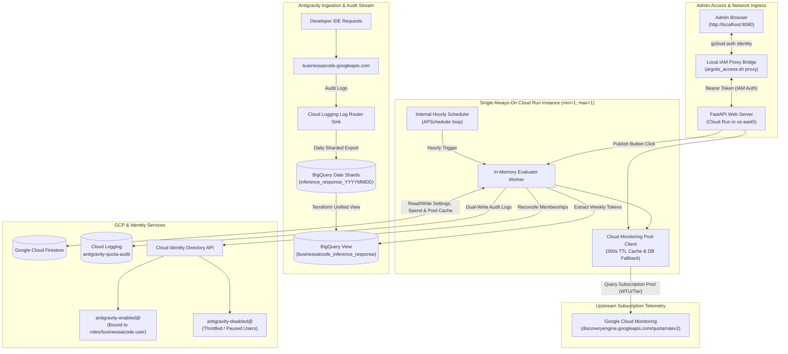
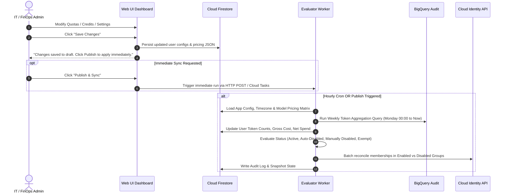
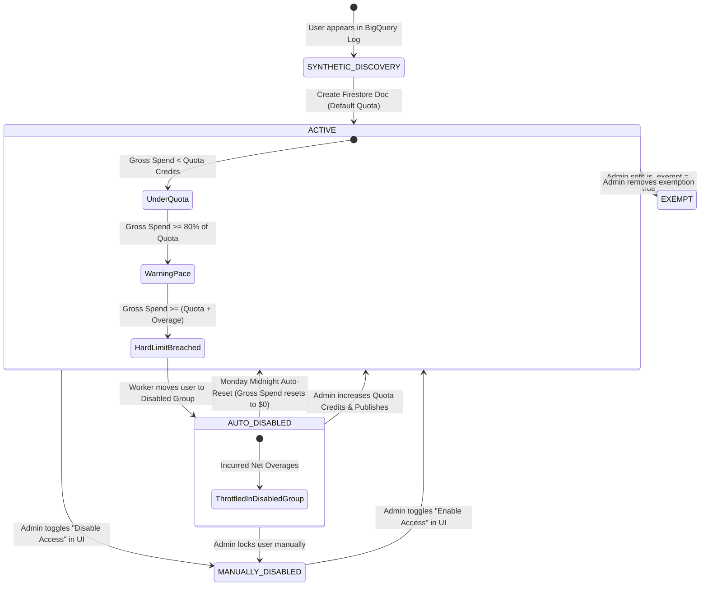
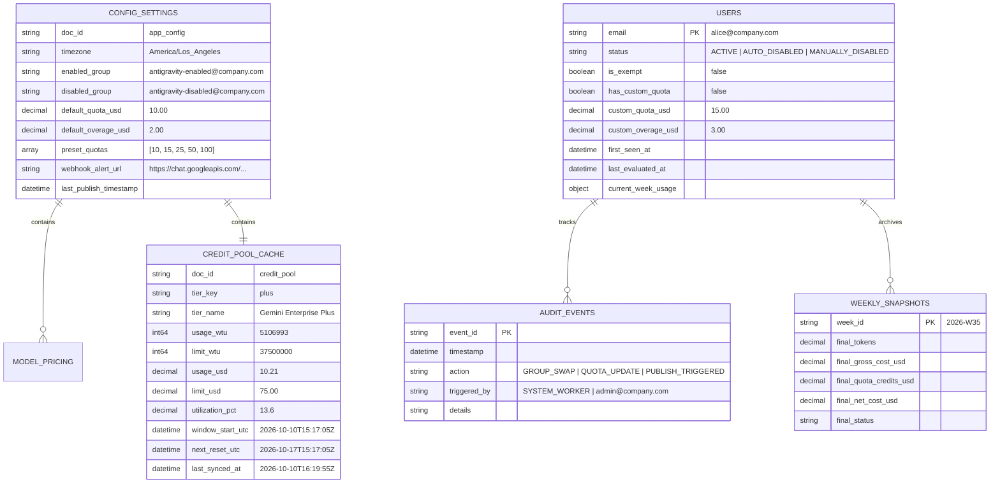
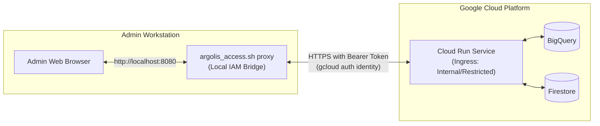

# Technical Design Document & Feature Specification: Antigravity Quota & Usage Management Portal

**Author**: Alan Blythe  
**Status**: APPROVED ARCHITECTURAL SPECIFICATION  
**Target Platform**: Google Cloud Platform (Single Always-On Cloud Run Instance, Firestore, BigQuery, Cloud Identity)

---

## 1. Executive Summary & Objective

The **Antigravity Quota & Usage Management Portal** provides fine-grained visibility, credit tracking, cost estimation, and automated access governance for developer access to Google Antigravity (Gemini Enterprise AI Developer Tools).

> [!NOTE]
> **Independent Quota Governance & Upstream Pool Visibility**: Gemini Enterprise enforces subscription quota as a pooled entitlement at the GCP project level. This portal establishes a **two-layer visibility and governance model**:
> 1. **Upstream Subscription Quota Pool**: Direct read-only telemetry from **Google Cloud Monitoring** (`discoveryengine.googleapis.com/quota/ratev2/...`), providing live organizational visibility into subscription license tier, gross Workload Token Unit (WTU) consumption, contract USD value, and the official Google Cloud weekly reset schedule.
> 2. **Per-Developer Allocation & Access Governance**: An independent management layer where administrators define per-developer credit budgets, track estimated usage from BigQuery inference logs, and automate access enforcement via Cloud Identity groups (`antigravity-enabled@` vs `antigravity-disabled@`).

To minimize architectural complexity and infrastructure overhead, the system is deployed as a **single, always-on minimal Cloud Run instance** (`min-instances: 1`, `max-instances: 1`, 1 vCPU, 512MB RAM). This single instance hosts:
1. **The Web Dashboard & REST API**: Instantaneous page loads with zero cold starts for admin users.
2. **Cloud Monitoring Quota Pool Client**: Maintains an in-memory cache with a 300-second TTL and automatic Firestore fallback, polling live subscription tier and WTU telemetry without burdening GCP quota limits.
3. **The Embedded Background Worker**: Runs an internal scheduler (Python `APScheduler` loop) to evaluate developer quotas hourly and refresh pool statistics, completely eliminating the need for external Cloud Scheduler cron jobs.
4. **Instant Publish Handler**: Exposes an in-process trigger invoked whenever the admin clicks "Publish & Sync" in the UI to immediately reconcile identity groups and refresh pool metrics.



---

## 2. Financial Ledger, Cost Calculation & Credit Mechanics

### 2.1 The Credit vs. Net Cost Model
In Antigravity enterprise deployments, user quotas are distributed as **credit allocations**. To provide accurate FinOps reporting, the system calculates both gross usage and net liability:

1. **Gross Estimated Cost ($C_{\text{gross}}$)**:
   $$\text{Blended Rate Per 1M Tokens } (R_{\text{blended}}) = (w_{\text{in}} \cdot P_{\text{in}}) + (w_{\text{out}} \cdot P_{\text{out}}) + (w_{\text{cache}} \cdot P_{\text{cache}})$$
   $$C_{\text{gross}} = \frac{T_{\text{total}} \times R_{\text{blended}}}{1,000,000}$$

2. **Allocated Quota Credits ($Q$)**:
   The weekly credit amount granted to the developer (e.g. \$10.00).

3. **Remaining Credit Balance ($B_{\text{credit}}$)**:
   $$B_{\text{credit}} = \max(0, Q - C_{\text{gross}})$$

4. **Net Cost / Developer Overage ($C_{\text{net}}$)**:
   $$C_{\text{net}} = \max(0, C_{\text{gross}} - Q)$$
   *(Note: Because Gemini Enterprise utilizes pooled project-level quotas, $C_{\text{net}}$ measures an individual developer's consumption exceeding their allocated quota target, rather than external GCP billing liability.)*

5. **Throttling Condition**:
   A user exceeds allowed usage when their Gross Cost exceeds their Quota Credits plus their allowed Overage Buffer ($O$):
   $$\text{Throttled if: } C_{\text{gross}} \ge Q + O \quad \iff \quad C_{\text{net}} \ge O$$

### 2.2 Global Estimation Disclaimer
To avoid visual clutter while maintaining legal/accounting compliance, the application features a **single, prominent disclaimer banner** pinned to the dashboard header / footer:

> ℹ️ **Estimation Notice**: *All token breakdowns, cost calculations, credit balances, and spend metrics displayed in this portal are estimated projections calculated from raw token counts and configured model pricing assumptions.*

### 2.3 Upstream Subscription Quota Pool Mechanics (Cloud Monitoring)

While Section 2.1 governs internal developer credit allocations, the organization's overarching entitlement is governed by its Gemini Enterprise contract tier. The portal interfaces with **Google Cloud Monitoring API v3** to track and display this upstream quota pool:

1. **Upstream Quota Metrics**:
   - Usage: `discoveryengine.googleapis.com/quota/ratev2/net_usage`
   - Limit: `discoveryengine.googleapis.com/quota/ratev2/limit`
   - Evaluated across subscription tiers via `metric.label.quota_metric_name`:
     - **`agentic_wtu_tier_enterprise_plus_pp_weekly_regional`**: Gemini Enterprise Plus (37.5M WTU limit, \$75.00 contract value at \$2.00 / 1M WTU).
     - **`agentic_wtu_tier_enterprise_standard_pp_weekly_regional`**: Gemini Enterprise Standard (40M WTU limit, \$80.00 contract value).
     - **`agentic_wtu_tier_consumption_only_pp_weekly_regional`**: Consumption-Only / Flex.

2. **Official Reset Cycle & Countdown**:
   - The upstream quota engine defines the start of each weekly window via the metric point label `window_start_time` (epoch seconds).
   - Window Start: $T_{\text{window\_start}} = \text{datetime.fromtimestamp}(\text{window\_start\_time})$.
   - Next Weekly Reset: $T_{\text{next\_reset}} = T_{\text{window\_start}} + 7 \text{ days}$.
   - Countdown Duration: $T_{\text{remaining}} = \max(0, T_{\text{next\_reset}} - T_{\text{now}})$, formatted dynamically as `Weekly Pool Resets in: Xd Xh`.

3. **In-Memory Caching & Firestore Resiliency**:
   - High-frequency web UI polling is shielded by a **300-second in-memory TTL cache** in `CloudMonitoringPoolClient`.
   - On every successful upstream read, current metrics are mirrored to Firestore document `config/credit_pool`.
   - If Cloud Monitoring queries fail due to quota limits or transient network issues, the client transparently returns the last valid Firestore snapshot.

---

## 3. Core Architecture & Workflow Model

### 3.1 The "Save" vs. "Publish" Admin Lifecycle

To provide operational safety and batch management, administrative actions in the web UI follow a **Deferred Sync with Instant Publish** pattern:



1. **Save Changes**: Persists user quota overrides, overage amounts, exemptions, and model pricing directly to Firestore without immediately invoking external APIs.
2. **Publish & Sync**: Immediately triggers the in-process background evaluator worker to re-run the BigQuery consumption query, re-calculate gross vs. net spend, and reconcile Cloud Identity groups in real-time.
3. **Embedded Scheduled Run**: The container's internal background scheduler (`APScheduler` / `asyncio` loop) triggers the evaluator worker every hour as an automated background safety net without requiring external cron infrastructure.

---

## 4. Dual-Group Identity State Machine

### 4.1 Group Definitions & IAM Roles

| Group Email | GCP IAM Role Binding | Purpose |
| :--- | :--- | :--- |
| `antigravity-enabled@yourcompany.com` | `roles/businessaicode.user` | **Active Developers**: Grants permission to run Antigravity inference. |
| `antigravity-disabled@yourcompany.com` | *None* | **Throttled / Paused Developers**: Zero IAM privileges. Tracks all inactive developers for audit and notification lists. |

### 4.2 State Definitions & Transitions



### 4.3 State Matrix & Evaluator Action Rules

| State / Flag | Group Location | Evaluator Action on Quota Breach | Monday 00:00 Reset Behavior |
| :--- | :--- | :--- | :--- |
| **`ACTIVE`** (`is_exempt: false`) | `antigravity-enabled@` | If `C_gross >= Q + O`: Move to `antigravity-disabled@`, set state to `AUTO_DISABLED`. | Reset weekly gross token spend to `$0.00`. Credit balance resets to `Q`. Remain in `antigravity-enabled@`. |
| **`AUTO_DISABLED`** | `antigravity-disabled@` | User is throttled. If Admin increases `Q` such that `C_gross < Q + O`: Move to `antigravity-enabled@`, set state to `ACTIVE`. | **Auto-Re-enable**: Move user back to `antigravity-enabled@`, set state to `ACTIVE`. |
| **`MANUALLY_DISABLED`** | `antigravity-disabled@` | Manual lock. Evaluator never modifies group. | **Protected**: Ignored by Monday reset. User remains in `antigravity-disabled@`. |
| **`is_exempt: true`** | `antigravity-enabled@` | Quota checks bypassed. Usage is tracked and displayed, but user is never throttled. | Reset weekly counters. User remains in `antigravity-enabled@`. |

### 4.4 Automated Cloud Identity Group Provisioning (Terraform)

To eliminate manual directory setup, group creation and permission delegation are fully automated via Terraform ([`terraform/cloud_identity.tf`](file:///Users/ayratk/development/agy-quota-config-dash/terraform/cloud_identity.tf)):

1. **Group Provisioning (`google_cloud_identity_group`)**:
   - `antigravity-enabled@<domain>`: Tagged with `cloudidentity.googleapis.com/groups.discussion_forum`.
   - `antigravity-disabled@<domain>`: Tagged with `cloudidentity.googleapis.com/groups.discussion_forum`.
   - Configurable via `create_cloud_identity_groups = true/false` flag to support pre-existing groups.
2. **Access Entitlement (`google_project_iam_member`)**:
   - Automatically binds `roles/businessaicode.user` directly to `group:antigravity-enabled@<domain>`.
   - The disabled group receives no project IAM roles.
3. **Least-Privilege Group Delegation (`google_cloud_identity_group_membership`)**:
   - The Cloud Run Portal Service Account (`antigravity-quota-portal@<project>.iam.gserviceaccount.com`) is assigned roles `["MEMBER", "OWNER"]` scoped strictly inside both groups.
   - This eliminates the need for project-level IAM Admin privileges or organization-wide Super Admin credentials; the service account can only modify memberships within these two designated groups.

---

## 5. Token Cost Modeling Engine & "Hinge Points"

### 5.1 Per-Model Configuration Schema

```json
{
  "models": {
    "gemini-3-pro": {
      "display_name": "Gemini 3.1 Pro / 3.0 Pro",
      "log_pattern": "%3%pro%",
      "input_price_per_million": 1.25,
      "output_price_per_million": 5.00,
      "cached_price_per_million": 0.30,
      "estimated_input_ratio": 0.70,
      "estimated_output_ratio": 0.20,
      "estimated_cached_ratio": 0.10
    },
    "gemini-2.5-pro": {
      "display_name": "Gemini 2.5 Pro",
      "log_pattern": "%2.5%pro%",
      "input_price_per_million": 1.25,
      "output_price_per_million": 5.00,
      "cached_price_per_million": 0.30,
      "estimated_input_ratio": 0.70,
      "estimated_output_ratio": 0.20,
      "estimated_cached_ratio": 0.10
    },
    "gemini-3.5-flash": {
      "display_name": "Gemini 3.5 Flash",
      "log_pattern": "%3.5%flash%",
      "input_price_per_million": 0.15,
      "output_price_per_million": 0.60,
      "cached_price_per_million": 0.0375,
      "estimated_input_ratio": 0.75,
      "estimated_output_ratio": 0.20,
      "estimated_cached_ratio": 0.05
    },
    "gemini-3.8-flash": {
      "display_name": "Gemini 3.8 Flash (Antigravity Default)",
      "log_pattern": "%3.8%flash%",
      "input_price_per_million": 0.075,
      "output_price_per_million": 0.30,
      "cached_price_per_million": 0.01875,
      "estimated_input_ratio": 0.80,
      "estimated_output_ratio": 0.15,
      "estimated_cached_ratio": 0.05
    },
    "gemini-3.6-flash": {
      "display_name": "Gemini 3.6 / 3.7 Flash",
      "log_pattern": "%3.6%flash%",
      "input_price_per_million": 0.075,
      "output_price_per_million": 0.30,
      "cached_price_per_million": 0.01875,
      "estimated_input_ratio": 0.80,
      "estimated_output_ratio": 0.15,
      "estimated_cached_ratio": 0.05
    },
    "gemini-2.5-flash": {
      "display_name": "Gemini 2.5 Flash",
      "log_pattern": "%2.5%flash%",
      "input_price_per_million": 0.075,
      "output_price_per_million": 0.30,
      "cached_price_per_million": 0.01875,
      "estimated_input_ratio": 0.80,
      "estimated_output_ratio": 0.15,
      "estimated_cached_ratio": 0.05
    },
    "default_fallback": {
      "display_name": "Default Model Fallback",
      "log_pattern": "default",
      "input_price_per_million": 0.15,
      "output_price_per_million": 0.60,
      "cached_price_per_million": 0.0375,
      "estimated_input_ratio": 0.75,
      "estimated_output_ratio": 0.20,
      "estimated_cached_ratio": 0.05
    }
  }
}
```

---

## 6. Timezone & Weekly Boundary Engine

### 6.1 Timezone Normalization
* The application stores a single global **App Timezone** (e.g. `America/Los_Angeles`, `America/New_York`, or `UTC`).
* **Weekly Window**: Begins strictly at **Monday 00:00:00** and ends at **Sunday 23:59:59** in the configured application timezone.
* All developers across all global regions are measured against this unified weekly budget boundary.

### 6.2 Date-Sharded Log Export & Consolidated BigQuery View

The Cloud Logging sink writes inference logs to BigQuery in date-sharded tables (`businessaicode_googleapis_com_inference_response_YYYYMMDD`). To enable uninterrupted queries across week boundaries without requiring table-partitioning restructuring:
1. **Terraform-Managed View**: A BigQuery view named `businessaicode_googleapis_com_inference_response` is provisioned across all table shards:
   ```sql
   CREATE OR REPLACE VIEW `{{PROJECT_ID}}.{{DATASET_NAME}}.businessaicode_googleapis_com_inference_response` AS
   SELECT * FROM `{{PROJECT_ID}}.{{DATASET_NAME}}.businessaicode_googleapis_com_inference_response_*`;
   ```
2. **Wildcard Fallback**: Application queries in [`app/bq/bq_client.py`](file:///Users/ayratk/development/agy-quota-config-dash/app/bq/bq_client.py) target `{self.project_id}.{self.dataset_name}.businessaicode_googleapis_com_inference_response*`, supporting both the unified view and raw wildcard table matches.

### 6.3 Structured Telemetry Payload (`metadata`)

Every log entry under `businessaicode.googleapis.com/inference_response` contains a structured JSON payload:

```json
{
  "timestamp": "2026-10-08 18:09:45.800408 UTC",
  "labels": {
    "user_id": "user:developer@company.com",
    "model": "gemini-3.8-flash",
    "request_id": "893c834a-9eef-4f6c-8472-a8c7df3158c8",
    "trajectory_id": "400ad99f-7f72-4d5f-9f79-6ea43a18e03e"
  },
  "jsonpayload_v1_inferenceresponselog": {
    "metadata": {
      "totaltokencount": 107315,
      "prompttokencount": 106636,
      "candidatestokencount": 193,
      "thoughtstokencount": 486,
      "cachedcontenttokencount": 101525,
      "quotatype": "REGULAR_QUOTA"
    }
  }
}
```

Key telemetry fields parsed by the evaluator:
* **`totaltokencount`**: Full token volume per interaction.
* **`prompttokencount`**: Prompt/input tokens.
* **`candidatestokencount`**: Completion/output response tokens.
* **`thoughtstokencount`**: Internal chain-of-thought/reasoning tokens.
* **`cachedcontenttokencount`**: Context cache savings.
* **`quotatype`**: Quota type flag (`REGULAR_QUOTA`).

### 6.4 BigQuery Parametrized Extraction Query

```sql
-- Parametrized BigQuery Usage Aggregation
-- @start_timestamp_utc and @end_timestamp_utc are calculated from App Timezone (Monday 00:00 to Now)
WITH raw_events AS (
  SELECT
    timestamp,
    REPLACE(labels.user_id, 'user:', '') AS user_email,
    COALESCE(labels.model, 'gemini-3.8-flash') AS model_name,
    COALESCE(
      SAFE_CAST(jsonpayload_v1_inferenceresponselog.metadata.totalTokenCount AS INT64),
      SAFE_CAST(jsonpayload_v1_inferenceresponselog.metadata.totaltokencount AS INT64),
      0
    ) AS total_tokens
  FROM
    `{{PROJECT_ID}}.{{DATASET_NAME}}.businessaicode_googleapis_com_inference_response*`
  WHERE
    timestamp >= @start_timestamp_utc
    AND timestamp <= @end_timestamp_utc
)
SELECT
  user_email,
  model_name,
  COUNT(1) AS request_count,
  SUM(total_tokens) AS token_count,
  MAX(timestamp) AS last_active
FROM
  raw_events
WHERE
  user_email IS NOT NULL
  AND NOT ENDS_WITH(user_email, '.gserviceaccount.com')
GROUP BY
  user_email,
  model_name;
```

---

## 7. Firestore Database Schema

Firestore stores the application settings, user configurations, weekly consumption, credit ledgers, and upstream subscription quota pool cache.



### 7.1 Firestore User Document (`users/{user_email}`)

```json
{
  "email": "alice@yourcompany.com",
  "status": "ACTIVE",
  "is_exempt": false,
  "has_custom_quota": true,
  "custom_quota_usd": 20.00,
  "custom_overage_usd": 5.00,
  "current_week": {
    "week_id": "2026-W35",
    "total_tokens": 3450000,
    "total_requests": 240,
    "gross_spend_usd": 14.85,
    "quota_credits_usd": 20.00,
    "remaining_credit_usd": 5.15,
    "net_billable_cost_usd": 0.00,
    "overage_buffer_usd": 5.00,
    "spend_breakdown": {
      "input_spend_usd": 10.40,
      "output_spend_usd": 3.85,
      "cached_spend_usd": 0.60
    },
    "tokens_by_model": {
      "gemini-3-pro": 2500000,
      "gemini-3.6-flash": 950000
    },
    "credit_utilization_percentage": 74.25,
    "last_active": "2026-08-27T11:42:10Z"
  },
  "created_at": "2026-08-01T09:00:00Z",
  "updated_at": "2026-08-27T12:00:00Z"
}
```

### 7.2 Firestore Credit Pool Cache Document (`config/credit_pool`)

Persists the latest upstream Google Cloud Monitoring subscription pool metrics to provide instant dashboard loads and offline/rate-limit fallback:

```json
{
  "tier_key": "plus",
  "tier_name": "Gemini Enterprise Plus",
  "usage_wtu": 5106993,
  "limit_wtu": 37500000,
  "usage_usd": 10.21,
  "limit_usd": 75.00,
  "utilization_pct": 13.6,
  "window_start_utc": "2026-10-10T15:17:05Z",
  "next_reset_utc": "2026-10-17T15:17:05Z",
  "last_synced_at": "2026-10-10T16:19:55.420160Z"
}
```

---

## 8. Web Application UI/UX Specification

### 8.1 Global Estimation Disclaimer & Top Banner
* **Single Disclaimer**: Displayed once at the top of the portal below the application header:
  * *"ℹ️ All token breakdown percentages, gross spend figures, credit balances, and net cost metrics are estimated projections calculated from raw token telemetry logs and configured model pricing assumptions."*

### 8.2 Upstream Hero Widget: Antigravity Weekly Quota Pool Card
Positioned prominently above the developer management table, this hero component renders live upstream contract entitlement data fetched from Google Cloud Monitoring:
* **Header & Identity**:
  * Cloud Icon + Title: **`Antigravity Weekly Quota Pool`**
  * Tier Badge: **`Tier: Gemini Enterprise Plus`** (or Standard / Flex)
  * Information Tooltip: Clarifies that this card represents the upstream Google Cloud Subscription Quota Pool from Cloud Monitoring, distinct from internal developer credit targets.
* **Cycle Countdown & Timestamps**:
  * Countdown Pill: **`Weekly Pool Resets in: Xd Xh`** (e.g. `Weekly Pool Resets in: 6d 22h`)
  * Dual Timestamps: Displays exact reset moment in both UTC and local browser time (e.g. `Oct 17, 15:17 UTC · Oct 17, 11:17 Local`).
* **Dual Consumption Metrics**:
  * Primary Spend: **`$10.21 / $75.00 limit`** with color-coded utilization indicator (`13.6% utilized`).
  * Secondary WTU Raw Tokens: **`5,106,993 / 37,500,000 WTU (5.11M / 37.50M)`**.
* **Progress Bar**: Multi-stage visual progress bar with smooth transitions (Emerald `<80%`, Amber `80-100%`, Rose `>100%`).

### 8.3 Internal FinOps KPI Summary Cards
Six summary cards reflecting internal developer credit allocations and BigQuery telemetry:
* `Active Developers`: Number of developers in `ACTIVE` status.
* `Auto-Throttled`: Number of developers currently paused in `antigravity-disabled@`.
* `Tokens This Week`: Total weekly token volume (e.g. `53.54M`).
* `Gross Usage`: Aggregated developer token spend across all models (e.g. `$6.48`).
* `Credits Allocated`: Sum of all granted developer quotas (e.g. `$23.00`).
* `Net Overages`: Cumulative spend exceeding individual quotas (e.g. `$0.88`).

### 8.4 Developer Governance Table

| Column Name | Data Type | Sortable | Display / Visual Elements |
| :--- | :--- | :---: | :--- |
| **User** | String | Yes | Gravatar/Avatar + Developer Email (`user@company.com`) |
| **Status** | Enum | Yes | 🟢 `Active` \| 🟡 `Warning (>80%)` \| 🔴 `Auto-Throttled` \| 🔒 `Locked` \| ⚪ `Exempt` |
| **Total Tokens** | Integer | Yes | Formatted with commas (`3,450,000`) |
| **Gross Usage** | Currency | Yes | **$14.85** *(Total token value)* |
| **Quota Credits** | Currency | Yes | **$20.00** *(Granted allowance)* |
| **Credit Balance / Net Overage** | Currency | Yes | If `C_gross <= Q`: **$5.15 Left** 🟢<br>If `C_gross > Q`: **+$2.40 Net Overage** 🔴 |
| **Credit Utilization** | Percentage | Yes | Progress Bar with dynamic color (`<80% Green`, `80-100% Yellow`, `>100% Red`) |
| **Last Active** | Relative Time | Yes | "12 minutes ago" |
| **Actions** | Action Menu | No | `[ Quick Edit Quota ]` \| `[ Disable / Lock ]` \| `[ Set Exempt ]` |

### 8.5 User Detail Slide-out Drawer
Clicking any user row opens a slide-out drawer containing:
1.  **Credit & Cost Ledger**:
    *   **Gross Token Value**: \$14.85
    *   **Allocated Credits**: \$20.00
    *   **Remaining Credit Balance**: \$5.15
    *   **Net Billable Overage**: \$0.00
2.  **Usage & Cost Donut Chart**: Breakdown by model (`Gemini 3 Pro` vs `Gemini 3.6 Flash`).
3.  **Hinge Point Breakdown**: Estimated Input vs Output vs Cached token volume and dollar amounts.
4.  **Quota Configuration Form**:
    *   Radio buttons for presets (\$10, \$15, \$25, \$50, \$100) or Custom Text Input (\$XX.XX).
    *   Overage Buffer Input (\$XX.XX).
    *   `Exempt from Quota Controls` Checkbox.
    *   `Manually Lock / Disable User` Toggle.
### 8.6 Developer Onboarding ("Add Developer" Dialog)
In addition to synthetic discovery from BigQuery telemetry, administrators can manually pre-provision developers:
* **Interactive Modal**: Admin enters developer email, selects weekly credit target (default or custom), sets overage buffer, and sets exemption status.
* **REST API**: Invokes `POST /api/users` to initialize the developer in Firestore with status `ACTIVE`.
* **Instant Group Assignment**: Upon "Publish & Sync", the evaluator verifies and adds the developer to `antigravity-enabled@`.

---

## 9. Security & Minimal Privilege IAM Model

| Identity / Service Account | Granted IAM Roles | Scoped Resource | Purpose |
| :--- | :--- | :--- | :--- |
| **Cloud Run Portal SA** (`antigravity-quota-portal@...`) | `roles/monitoring.viewer` | GCP Project | Queries upstream Gemini Enterprise subscription quota metrics (`discoveryengine.googleapis.com/quota/ratev2`). |
| **Cloud Run Portal SA** (`antigravity-quota-portal@...`) | `roles/bigquery.dataViewer`<br>`roles/bigquery.jobUser` | BigQuery Dataset & Project | Queries weekly developer token logs. |
| **Cloud Run Portal SA** (`antigravity-quota-portal@...`) | `roles/datastore.user` | Cloud Firestore | Manages configurations, quotas, user states, subscription pool cache, and audit trails. |
| **Cloud Run Portal SA** (`antigravity-quota-portal@...`) | `roles/logging.logWriter` | GCP Project | Emits structured compliance audit logs to Cloud Logging (`antigravity-quota-audit`). |
| **Cloud Run Portal SA** (`antigravity-quota-portal@...`) | `roles/serviceusage.serviceUsageConsumer` | GCP Project | Consumes BigQuery, Cloud Monitoring, and logging APIs without project admin rights. |
| **Cloud Run Portal SA** (`antigravity-quota-portal@...`) | Cloud Identity **Owner & Member** | `antigravity-enabled@`<br>`antigravity-disabled@` | Reconciles developer memberships. **Zero GCP project IAM admin rights.** |
| **Admin Users / Domains** (e.g. `domain:gcp.altostrat.com`) | `roles/run.invoker` | Cloud Run Service | Authorized invocation of the web dashboard and REST APIs under IAM authentication. |
| **Cloud Logging Sink Writer** (`service-PROJECT_NUM@gcp-sa-logging...`) | `roles/bigquery.dataEditor` | `antigravity_inference_logs` Dataset | Ingests `businessaicode.googleapis.com` logs from Cloud Logging into BigQuery. |

---

## 10. Enterprise Ingress & Secure Access (Argolis Environments)

In high-governance and Argolis sandbox environments, Google Cloud organization policies strictly forbid public unauthenticated Cloud Run endpoints (`allUsers`). The system accommodates this via two complementary access patterns:



1. **Local Authenticated IAM Proxy Bridge (`scripts/argolis_access.sh`)**:
   - Runs a lightweight background proxy on the administrator's workstation (`http://localhost:8080`).
   - Automatically refreshes and attaches the active `gcloud` identity token to all outbound requests:
     ```bash
     ./scripts/argolis_access.sh proxy --port 8080 --region us-east5 --project ge-ent-app-demo
     ```
   - Allows instant browser testing without exposing the Cloud Run service to the public Internet or bypassing Org Policies.
2. **Internal Load Balancer (ILB) & Cloud Armor (Production Mode)**:
   - Terraform codifies optional Serverless Network Endpoint Group (NEG), internal forwarding rules, Cloud Armor security policies, and Identity-Aware Proxy (IAP) integration.

---

## 11. Dual-Write Audit Trail & Observability

To satisfy enterprise FinOps compliance and SIEM ingestion, all state changes are recorded using a dual-write architecture:

1. **Firestore Audit Trail**: Persisted to the `audit_events` collection for rendering in the administrative web UI with rich filtering.
2. **GCP Cloud Logging Emitter (`antigravity-quota-audit`)**:
   - Implemented via `CloudLoggingAuditEmitter` in [`app/core/logging_emitter.py`](file:///Users/ayratk/development/agy-quota-config-dash/app/core/logging_emitter.py).
   - Writes structured JSON payloads containing actor identity, event type (`GROUP_SWAP`, `QUOTA_UPDATE`, `MANUAL_LOCK`, `EVALUATOR_RUN`), previous state, new state, and impact.
   - Categorizes group swaps and overage throttling as `WARNING`/`NOTICE` severity.
   - Built with non-blocking error isolation so audit export failures never disrupt user requests.

---

## 12. Summary & Operational Status

The portal is actively running with:
1. **Live Inference Log Ingestion**: Ingesting daily sharded telemetry from `businessaicode.googleapis.com` via a consolidated BigQuery view.
2. **Dynamic Pricing Calibration**: Supporting current models including `gemini-3.8-flash`, `gemini-3.1-pro-preview`, and `gemini-3.5-flash-lite`.
3. **Automated Directory Governance**: Cloud Identity groups (`antigravity-enabled@` / `antigravity-disabled@`) fully provisioned and managed via Terraform.
4. **Upstream Quota Telemetry**: Google Cloud Monitoring ratev2 integration with 300s TTL in-memory caching and Firestore snapshot fallback, tracking organizational subscription tier, WTU token usage, and live 7-day reset countdowns.
5. **Argolis Compliance**: Zero unauthenticated exposure, IAM-authenticated invocation, and local proxy bridge for operational administration.
