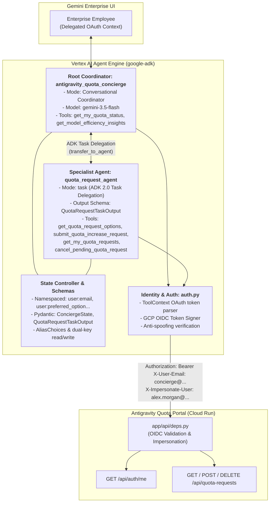

# Technical Design & Feature Specification: Antigravity Quota Concierge

**Document Version:** 2.0  
**Target Platform:** Google Vertex AI Agent Engine (Reasoning Engine), Gemini Enterprise  
**Framework:** Google Agent Development Kit (ADK) / Python SDK  
**Underlying Model:** `gemini-3.5-flash` (Global endpoint)  

---

## 1. Executive Summary & Objective

The **Antigravity Quota Concierge** (`antigravity_quota_concierge`) is a production-grade, multi-agent AI assistant built on the Google Agent Development Kit (ADK). Designed for large-scale enterprise deployments (15,000+ developers), the Concierge provides self-service quota diagnostics, automated access governance, model efficiency coaching, and structured quota increase workflows directly within **Gemini Enterprise**.

### Key Architectural Tenets
1. **Isolated Sub-Project Architecture:** The agent lives entirely within `concierge-agent/`. The parent portal container and root dependencies remain completely unburdened by heavy ADK dependencies.
2. **ADK 2.0 Task Delegation:** The sub-agent (`quota_request_agent`) operates in structured task mode (`mode="task"` with typed Pydantic `output_schema`), replacing open-ended conversation with deterministic task completion and typed handoffs.
3. **Structured State Control & Namespacing:** Cross-session user preferences and authenticated identity are managed via ADK's native `user:*` state namespace (`user:email`, `user:preferred_option`, `user:last_reason_category`), verified through Pydantic data models with dual-key backward compatibility.
4. **Zero-Trust Identity Resolution & Anti-Spoofing:** Caller identity is extracted exclusively from cryptographic platform context (`ToolContext` OAuth claims / Vertex AI invocation context) rather than caller-supplied model arguments.
5. **Zero-Dependency Testability:** An internal compatibility harness (`_adk_compat.py`) allows 100% of the unit test suite to execute in ~100ms offline without requiring `google-adk` or GCP network calls.

---

## 2. Multi-Agent Topology & Workflow

The Concierge utilizes a hierarchical multi-agent architecture with a root diagnostic coordinator and a specialized transactional subagent:



### 2.1 Agent Responsibilities

#### A. Root Coordinator Agent: `antigravity_quota_concierge`
- **Role:** Primary conversational interface for employee interactions.
- **Tools:**
  - `get_my_quota_status(tool_context)`: Queries `GET /api/auth/me` on behalf of the employee, populating quota, spend, group membership, and reset countdown.
  - `get_model_efficiency_insights(tool_context)`: Analyzes token consumption and expenditure breakdown across Frontier models (`Pro`, `Opus`, `Sonnet`) versus Lightweight models (`Flash`), recommending optimal model selection.
- **Delegation Protocol:** When an employee confirms they wish to request a quota increase (or check/cancel a pending request), the coordinator delegates execution to `quota_request_agent`.

#### B. Specialist Task Agent: `quota_request_agent`
- **Role:** Structured task agent handling the lifecycle of quota increase requests.
- **ADK 2.0 Execution Mode:** `mode="task"`.
- **Output Schema:** `QuotaRequestTaskOutput` (Pydantic model).
- **Tools:**
  - `get_quota_request_options(tool_context)`: Computes the 3 numbered preset packages (+$15 boost, +$25 recommended boost, +$50 permanent upgrade) relative to the employee's current tier, and provides the 5 reason categories.
  - `submit_quota_increase_request(option_number, reason_category, ...)`: Submits `POST /api/quota-requests` with normalized parameters.
  - `get_my_quota_requests(tool_context)`: Retrieves in-flight, approved, or rejected requests with reviewer notes and cooldown timers.
  - `cancel_pending_quota_request(request_id, tool_context)`: Withdraws or deletes a pending request (`DELETE /api/quota-requests/{id}`).
- **Task Completion Hand-off:** Upon successful submission, rejection, or cancellation, the agent populates `QuotaRequestTaskOutput` and signals task completion back to the coordinator.

---

## 3. State Management, Schemas & Memory Control

To avoid unstructured or fragile session state, the Concierge implements strict state namespacing and typed Pydantic validation:

### 3.1 State Namespacing Hierarchy
ADK supports persistent state keys prefixed with `user:`, allowing user preferences to survive across distinct conversational sessions.

| Scope | Key Name | Description | Persistence |
| :--- | :--- | :--- | :--- |
| **User Scope** | `user:email` | Verified corporate email of the employee | Cross-session |
| **User Scope** | `user:preferred_option` | User's preferred quota package option (1, 2, or 3) | Cross-session |
| **User Scope** | `user:last_reason_category` | Last justification category selected | Cross-session |
| **Session Scope** | `active_request_id` | ID of the current pending request (e.g. `req-demo-0001`) | Session-only |
| **Session Scope** | `current_quota_usd` | Employee's weekly quota limit in USD | Session-only |
| **Session Scope** | `current_spend_usd` | Employee's current weekly spend in USD | Session-only |
| **Session Scope** | `spend_by_model` | Model-by-model dollar breakdown | Session-only |

### 3.2 Dual-Key Compatibility Protocol
To guarantee that tools remain 100% backward-compatible with legacy callers and external API clients:
- **Read Operations:** Check the namespaced key first (e.g., `tool_context.state.get("user:email")`), falling back to the plain key (`resolved_user_email`).
- **Write Operations:** Mutate both the namespaced key and the legacy key simultaneously in `tool_context.state`.

### 3.3 Pydantic Data Models (`schemas.py`)

#### `QuotaRequestTaskOutput`
Structured output returned upon task completion:
```python
class QuotaRequestTaskOutput(BaseModel):
    status: Literal["SUBMITTED", "CANCELLED", "INFO_PROVIDED", "ERROR"]
    request_id: Optional[str] = None
    approved: Optional[bool] = None
    user_email: str
    requested_amount_usd: Optional[float] = None
    justification: Optional[str] = None
    rejection_reason: Optional[str] = None
    cooldown_until: Optional[str] = None
```

#### `ConciergeState`
Typed schema representing the agent's consolidated state, supporting alias resolution for raw dictionaries:
```python
class ConciergeState(BaseModel):
    model_config = ConfigDict(populate_by_name=True)

    user_email: Optional[str] = Field(
        default=None,
        validation_alias=AliasChoices("user:email", "resolved_user_email", "user_email"),
    )
    current_quota_usd: Optional[float] = None
    current_spend_usd: Optional[float] = None
    active_request_id: Optional[str] = None
    preferred_option_number: Optional[int] = Field(
        default=None,
        validation_alias=AliasChoices("user:preferred_option", "preferred_option_number"),
    )
    last_reason_category: Optional[str] = Field(
        default=None,
        validation_alias=AliasChoices("user:last_reason_category", "last_reason_category"),
    )
```

---

## 4. Security, Identity & Anti-Spoofing Architecture

The Concierge adheres to Google Cloud's Zero-Trust Agentic Architecture guidelines:

### 4.1 Strict Identity Precedence (`auth.py`)
To prevent Confused Deputy attacks and Insecure Direct Object Reference (IDOR) vulnerabilities, employee email extraction follows strict precedence:
1. **OAuth JWT Bearer Claims:** Cryptographically verified `email`, `upn`, or `preferred_username` claims extracted from `tool_context.auth_response` or `tool_context.state`.
2. **Platform Invocation Context:** Verified identity from Vertex AI Reasoning Engine / Discovery Engine session (`tool_context.user_id`, `get_invocation_context().user_id`).
3. **Local Development Fallback:** `DEFAULT_DEMO_USER_EMAIL` (active only in local mock mode).
4. **Untrusted Arguments Rejected:** Explicit `user_email` parameters provided by the LLM or end-user prompt are never trusted over platform-verified credentials.

### 4.2 Service-to-Service Ingress (`app/api/deps.py`)
1. **OIDC Verification:** When calling the Cloud Run backend, the Concierge signs requests using Google Cloud OIDC identity tokens targeted at the Cloud Run service URL audience.
2. **Impersonation Headers:** The request sends:
   - `Authorization: Bearer <Google-Signed-OIDC-Token>`
   - `X-User-Email: antigravity-concierge@<PROJECT_ID>.iam.gserviceaccount.com`
   - `X-Impersonate-User: <employee_email>`
3. **Non-Admin Blast-Radius Containment:** When the backend detects impersonated service account calls, `is_admin` is enforced as `False`. The Concierge can only query or submit records for that specific employee and is strictly barred from administrative endpoints (`require_admin`).

---

## 5. Portal Integration Contracts

The Concierge interacts with three core endpoints on the Antigravity Quota Portal backend:

### 5.1 `GET /api/auth/me`
- **Purpose:** Diagnostic status and usage telemetry.
- **Headers:** `X-Impersonate-User: <employee_email>`
- **Response Fields Utilized:**
  - `status`: `ACTIVE`, `AUTO_DISABLED`, or `MANUALLY_DISABLED`
  - `current_spend`: Gross week-to-date spend in USD
  - `effective_limit`: Current weekly quota in USD
  - `spend_by_model`: Dictionary mapping model family to spend
  - `tokens_by_model`: Dictionary mapping model family to token counts
  - `reset_countdown`: Human-readable time remaining until weekly reset

### 5.2 `POST /api/quota-requests`
- **Purpose:** Submit a new quota increase request.
- **Request Body:**
  ```json
  {
    "user_email": "alex.morgan@example.com",
    "requested_quota_usd": 31.00,
    "duration_type": "TEMPORARY_WEEKLY",
    "reason_category": "SPRINT_DEADLINE",
    "justification": "Option 2: Sprint deadline on checkout service"
  }
  ```
- **Response:**
  - `id`: Unique request identifier (`req-...`)
  - `status`: `PENDING`

### 5.3 `DELETE /api/quota-requests/{request_id}`
- **Purpose:** Cancel a pending request before admin review.
- **Response:** Status confirming cancellation.

---

## 6. Testing, Verification & Compatibility Layer

### 6.1 Zero-Dependency Test Harness (`_adk_compat.py`)
The Concierge provides an internal compatibility shim allowing full unit test execution without `google-adk` installed:
- Simulates `LlmAgent` supporting `mode`, `output_schema`, `tools`, and `sub_agents`.
- Simulates `ToolContext` with dictionary-backed `state` and helper methods.
- Simulates `AgentEngineApp` for packaging and deployment serialization.

### 6.2 Test Suite Execution
```bash
# Execute concierge agent unit tests (14 tests in ~100ms)
PYTHONPATH=concierge-agent python3 -m unittest discover -s concierge-agent/tests -p "test_*.py" -v

# Run Stage 1 automated 6-turn HTTP smoke test
python3 concierge-agent/run_local_stage1.py --smoke-test

# Dry-run Vertex AI Reasoning Engine deployment packaging
PYTHONPATH=concierge-agent python3 -m antigravity_quota_concierge.deploy_agent_engine --dry-run
```

---

## 7. Deployment & Publishing Specification

1. **GCS Artifact Staging:** Provisions `gs://<PROJECT_ID>-agent-engine-staging` in `us-central1` via Terraform (`terraform/storage.tf`).
2. **Vertex AI Reasoning Engine:** Deploys `AntigravityConciergeAdkApp` via `deploy.sh` with `spec.agent_framework = "google-adk"` and model `gemini-3.5-flash` (`GOOGLE_CLOUD_LOCATION="global"`).
3. **Gemini Enterprise Publishing:** Registered via `agents-cli publish gemini` targeting the enterprise App ID.
