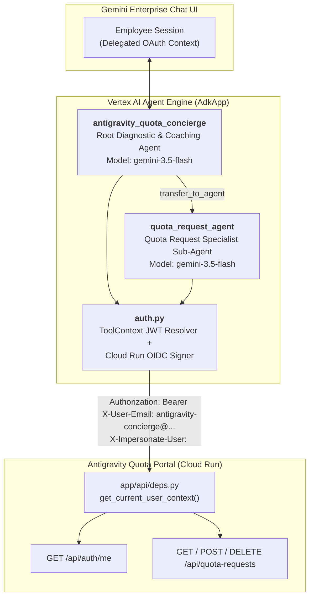

# Antigravity Quota Concierge — Technical Architecture

## 1. Multi-Agent Topology (`gemini-3.5-flash`)

The package defines a 2-agent hierarchy using the Google Agent Development Kit (`google-adk`) and `gemini-3.5-flash`:

### Root Agent: `antigravity_quota_concierge`
- **`get_my_quota_status()`**: Calls `GET /api/auth/me` and caches `current_quota_usd`, `current_spend_usd`, `group_id`, `spend_by_model`, and `active_request_id` in `tool_context.state`. Returns the exact diagnostic reply for paused (`AUTO_DISABLED` / `MANUALLY_DISABLED`), warning (`80%+`), or active accounts along with the weekly reset countdown (`reset_countdown`).
- **`get_model_efficiency_insights()`**: Analyzes `spend_by_model` and `tokens_by_model` from the employee's current week telemetry, calculating the percentage of spend on Frontier reasoning models (`Pro`, `Opus`, `Sonnet`) vs Lightweight models (`Flash`) and generating actionable FinOps coaching.

### Sub-Agent: `quota_request_agent` (ADK 2.0 Task Mode)
- **Task Mode & Output Schema**: Configured with `mode="task"` and typed Pydantic `output_schema=QuotaRequestTaskOutput`. When a request workflow terminates, it populates this schema and transfers control cleanly back to `antigravity_quota_concierge`.
- **`get_quota_request_options()`**: Computes the 3 numbered preset options relative to the employee's current weekly quota (`1: +$15.00 Temporary`, `2: +$25.00 Temporary [Recommended]`, `3: +$50.00 Permanent`) and returns the 5 reason categories (`SPRINT_DEADLINE`, `REFACTORING`, `INCIDENT`, `ROLE_UPGRADE`, `OTHER`) plus role-upgrade guidance for developers still in `business-users`.
- **`get_my_quota_requests()`**: Calls `GET /api/quota-requests` to inspect pending, approved, and rejected requests, surfacing reviewer notes (`admin_note`) and post-rejection cooldown timers (`cooldown_until`).
- **`submit_quota_increase_request()`**: Normalizes option numbers (`1`, `2`, `3`), increments (`+15`, `+25`, `+50`), reason categories, and durations (`TEMPORARY_WEEKLY` vs `PERMANENT`), persists `user:preferred_option` and `user:last_reason_category`, then submits `POST /api/quota-requests`.
- **`cancel_pending_quota_request()`**: Calls `DELETE /api/quota-requests/{request_id}` so an employee can withdraw or replace an existing pending request.

---

## 2. End-User Identity & Zero-Trust Impersonation Model

1. **Identity Extraction (`auth.py:resolve_employee_email`)**:
   - Inspects `tool_context.auth_response` and `tool_context.state` for verified email claims or OAuth/OIDC JWT tokens (`id_token`, `access_token`), decoding standard `email`, `upn`, or `preferred_username` claims.
   - Falls back to `DEFAULT_DEMO_USER_EMAIL` only in local development/demo mode.
2. **Service-to-Service Authentication (`auth.py:build_portal_auth_headers`)**:
   - Fetches a Google-signed OIDC ID token for the Cloud Run service URL audience (`google.oauth2.id_token.fetch_id_token`).
   - Sends `X-User-Email: antigravity-concierge@<PROJECT_ID>.iam.gserviceaccount.com` and `X-Impersonate-User: <employee_email>`.
3. **Portal Verification (`app/api/deps.py:get_current_user_context`)**:
   - The Portal verifies that `caller_email` matches `CONCIERGE_SERVICE_ACCOUNT_EMAIL` (or a trusted Vertex AI Reasoning Engine service agent) before honoring `X-Impersonate-User`.
   - Importantly, `is_admin` remains `False` when impersonating a regular employee, ensuring the Concierge can only read and submit requests for that employee and cannot invoke admin-only endpoints (`require_admin`).
