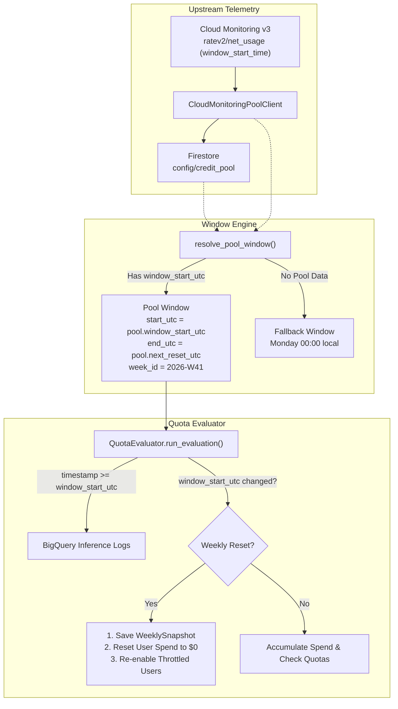

# Upstream Credit Pool-Aligned Weekly Quota Reset Implementation Plan

> **For agentic workers:** REQUIRED SUB-SKILL: Use `superpowers:subagent-driven-development` (recommended) or `superpowers:executing-plans` to implement this plan task-by-task. Steps use checkbox (`- [ ]`) syntax for tracking.

**Goal:** Align weekly inference usage aggregation and quota reset cycles directly with the authoritative `Current Weekly Credit Pool Start Time` (`window_start_utc`) queried from Cloud Monitoring (`scripts/validate_pool.py`) and stored in Firestore (`config/credit_pool`), replacing the artificial Monday 00:00 calendar reset.

**Architecture:** Introduce `resolve_pool_window()` in the timezone/window engine that prioritizes the active `CreditPoolStats.window_start_utc` over calendar calculations. Inject `pool_client` / Firestore `config/credit_pool` into `QuotaEvaluator` so BigQuery usage queries and weekly rollover logic (snapshotting, spend reset, auto-reenabling throttled developers) strictly track the actual Google Cloud subscription billing window.

**Tech Stack:** Python 3.14, FastAPI, Google Cloud Monitoring API, Google Cloud Firestore, BigQuery, Pydantic V2, Pytest.

---

## 1. Problem Context & Analysis

Currently, the evaluation engine (`app/core/evaluator.py`) calls `get_current_week_window(config.timezone, eval_time)`. This calculates:
* `start_utc`: Monday 00:00:00 in the configured local timezone (e.g. `America/Los_Angeles`).
* `end_utc`: Sunday 23:59:59.
* `week_id`: `f"{iso_year}-W{iso_week:02d}"`.

### The Problem
Google Cloud Antigravity's upstream rate quota (`discoveryengine.googleapis.com/quota/ratev2/.../net_usage`) operates on its own 7-day rolling window defined by the time series point label `window_start_time` (e.g. `2026-10-11 13:06:56 UTC`).
Because the dashboard resets developer spend at Monday 00:00:
1. When Monday 00:00 arrives, developer spend resets to \$0 and throttled developers are re-enabled, even though Google Cloud's upstream subscription quota pool is in the middle of its cycle.
2. Conversely, when Google Cloud's pool resets (e.g. on Sunday at 13:06:56 UTC), developer spend in the dashboard does not reset, leading to desynchronization between the hero widget's **Antigravity Weekly Quota Pool** and the developer spend table.

### The Solution
1. Use the authoritative `window_start_utc` and `next_reset_utc` from `CreditPoolStats` (cached in memory and stored in Firestore at `config/credit_pool`).
2. Point BigQuery usage aggregation (`fetch_weekly_usage`) to `[window_start_utc, now_utc]`.
3. Trigger weekly resets whenever `window_start_utc` advances to a new cycle (or `week_id` changes).
4. Provide a graceful fallback to calendar Monday 00:00 if no credit pool telemetry exists (e.g. cold start before first metric query).

---

## 2. Mermaid Architecture Flow



---

## Proposed Changes

### Component 1: Window Resolution Engine (`app/core/timezone_engine.py`)

#### [MODIFY] `app/core/timezone_engine.py`
- Add `resolve_pool_window(pool_stats: CreditPoolStats | None, fallback_timezone: str = "America/Los_Angeles", now_dt: datetime | None = None) -> tuple[str, datetime, datetime, datetime]`.
- When `pool_stats` has `window_start_utc`:
  - `start_utc = pool_stats.window_start_utc`
  - `end_utc = pool_stats.next_reset_utc or (start_utc + timedelta(days=7))`
  - `now_utc = now_dt or datetime.now(UTC)`
  - `week_id = f"{start_utc.isocalendar()[0]}-W{start_utc.isocalendar()[1]:02d}"`
  - Returns `(week_id, start_utc, end_utc, now_utc)`
- Preserve `get_current_week_window()` as the fallback implementation.
- Update `is_new_week()` to support checking both `week_id` and timestamp transitions.

---

### Component 2: Quota Evaluator (`app/core/evaluator.py`)

#### [MODIFY] `app/core/evaluator.py`
- Accept `pool_client: Any = None` in `QuotaEvaluator.__init__`.
- At start of `run_evaluation()`:
  - Fetch `pool_stats` from `self.pool_client.get_pool_stats()` if available, or `self.db.get_credit_pool()`.
  - Call `resolve_pool_window(pool_stats, config.timezone, eval_time)` to get `(week_id, start_utc, end_utc, now_utc)`.
- Query BigQuery usage with the resolved `start_utc` (aligning query window with the credit pool start time).
- Reset condition check:
  - Trigger reset if `is_new_week(user.current_week.week_id, week_id)` OR `(user.current_week.window_start_utc and user.current_week.window_start_utc != start_utc)`.
- Store `user.current_week.window_start_utc = start_utc`.
- Update state transition reason from `WEEKLY_MONDAY_RESET` to `WEEKLY_POOL_RESET`.

---

### Component 3: Data Models & Schema (`app/db/models.py`)

#### [MODIFY] `app/db/models.py`
- Add optional `window_start_utc: datetime | None = None` to `CurrentWeekUsage` for explicit cycle tracking.
- Set default to `None` for full backward compatibility.

---

### Component 4: API Endpoints & Dependency Injection (`app/api/`)

#### [MODIFY] `app/api/deps.py`
- In `get_evaluator()`: inject `pool_client=get_pool_client()`.

#### [MODIFY] `app/api/routes_evaluator.py`
- In `get_kpi_stats()`: resolve `week_id` via `resolve_pool_window()` using the active `pool_stats`.

#### [MODIFY] `app/api/routes_users.py`
- In `create_user()`: resolve initial `week_id` and `window_start_utc` via `resolve_pool_window()`.

---

### Component 5: Cloud Monitoring Pool Client & Script (`app/monitoring/`, `scripts/`)

#### [MODIFY] `app/monitoring/pool_client.py`
- In `_query_window_timestamps()`: widen the time series search window to `[now - 8 days, now]` so `window_start_time` is always found even during periods of zero traffic since midnight.

#### [MODIFY] `scripts/validate_pool.py`
- Add `--sync-firestore` / `--save` CLI flag to optionally write `CreditPoolStats` directly into Firestore (`config/credit_pool`) when running from the terminal.

---

## Verification Plan

### Automated Tests
Run full test suite via pytest:
```bash
./.venv/bin/pytest -v tests/
```
Include dedicated new tests in:
1. `tests/test_timezone.py`:
   - `test_resolve_pool_window_with_credit_pool`: verify `start_utc`, `end_utc`, and `week_id` match `window_start_utc`.
   - `test_resolve_pool_window_fallback_when_none`: verify fallback to local Monday calculation.
2. `tests/test_evaluator.py`:
   - `test_evaluator_uses_pool_window_start_time`: verify BigQuery query timestamp matches `window_start_utc`.
   - `test_evaluator_pool_reset_advancement`: verify that advancing `window_start_utc` triggers snapshot archival and re-enables throttled users.
   - `test_evaluator_no_reset_across_calendar_monday`: verify that crossing calendar Monday 00:00 does *not* reset spend if the credit pool `window_start_utc` has not changed.

### Manual Verification via Live Cloud Run Proxy
1. Ensure proxy bridge is running (`./scripts/argolis_access.sh proxy`).
2. Trigger manual evaluation: `curl -X POST http://localhost:8080/api/evaluator/run`.
3. Check KPIs: `curl http://localhost:8080/api/evaluator/kpis`.
   - Verify `week_id` matches the active credit pool week.
   - Verify `total_gross_usage_usd` and developer table usage reflect inference starting from `window_start_utc` (`2026-10-11T13:06:56Z`).
4. Inspect web dashboard in browser at `http://localhost:8080`.
